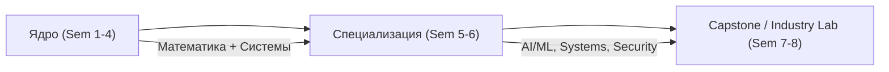
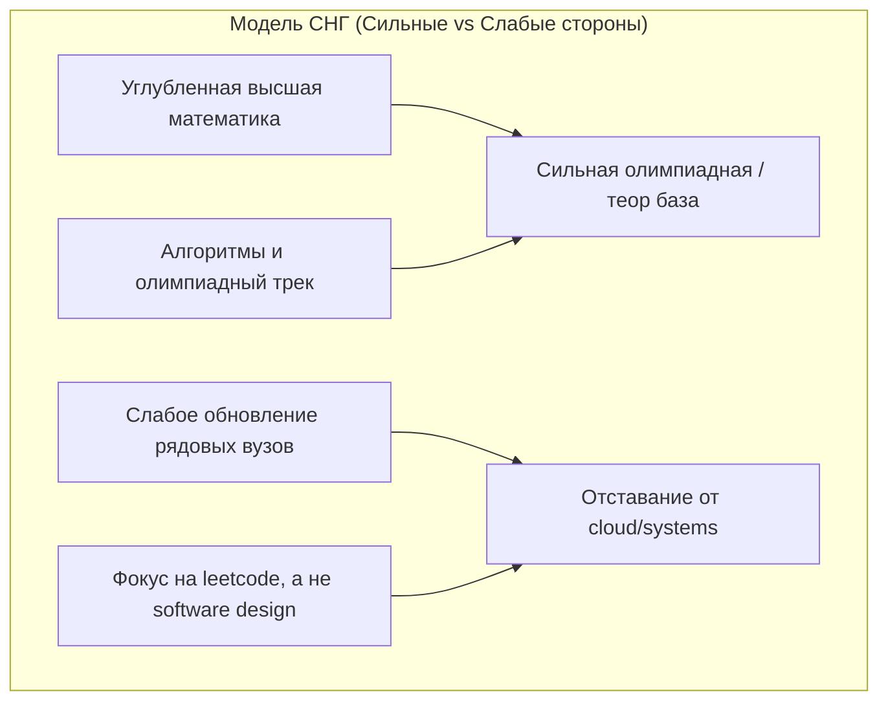
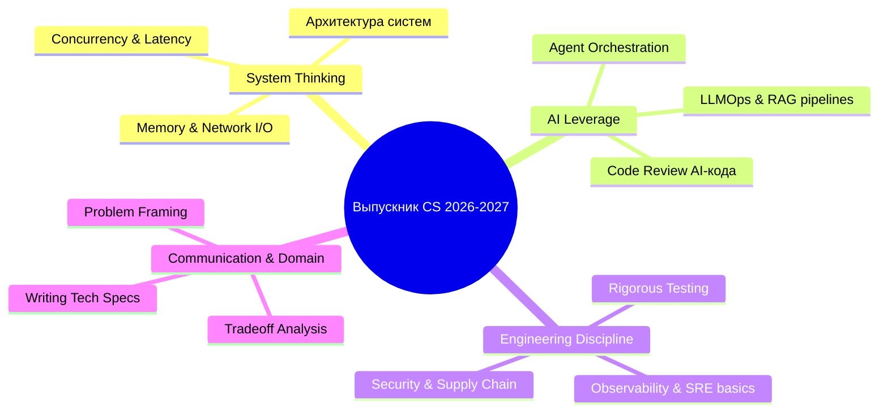
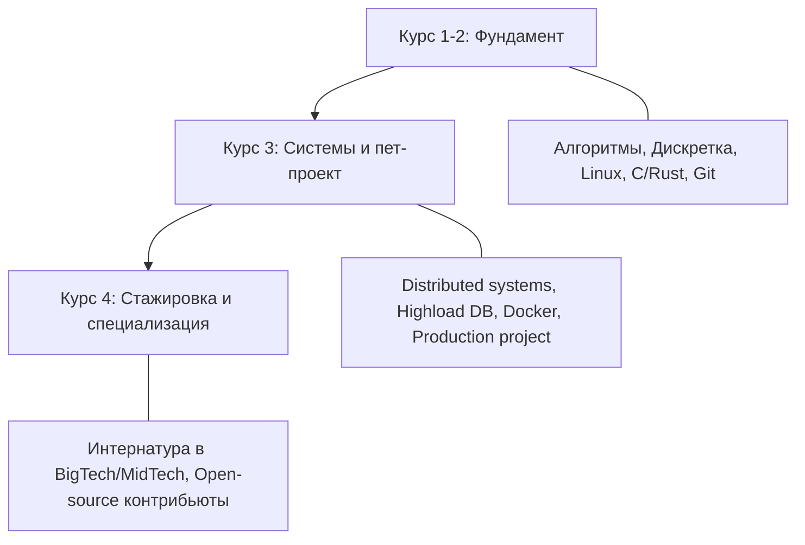

# Анализ программ Computer Science (Мир vs СНГ) и требования рынка к выпускникам (2026–2027)

---

## 1. Чему обучают в ведущих университетах мира

Мировые CS-программы (MIT, Stanford, CMU, UC Berkeley, ETH Zurich, NUS, Tsinghua) опираются на модель **«фундаментальные абстракции + специализация + сквозной production-проект»**.

### Академическое ядро (Common Core)
* **Дискретная математика и матлогика:** теория графов, комбинаторика, теория вероятностей, статистика, линейная алгебра.
* **Computer Systems & Architecture:** устройство процессоров, иерархия памяти, ассемблер (RISC-V/x86), параллелизм на уровне инструкций (CMU 15-213 / CS:APP).
* **Operating Systems & Distributed Systems:** процессы, потоки, планировщики, виртуальная память, консенсус (Raft/Paxos), RPC, изоляция контейнеров (xv6, Rust OS labs).
* **Алгоритмы и структуры данных:** асимптотический анализ, структуры данных внешней памяти, вероятностные структуры (Bloom filters, HyperLogLog), потоковые алгоритмы.
* **Теория языков программирования и компиляторы:** лексический/синтаксический анализ, AST, семантика, LLVM IR, верификация типов (Rust, OCaml, Haskell).

### Тренды глобальных программ к 2026 году
1. **Сдвиг системного ядра на Rust / modern C++:** вытеснение чистого C в курсах ОС и системного программирования для акцента на memory safety.
2. **AI-native Software Engineering:** включение курсов по спецификации, формальной верификации, тестированию сгенерированного кода и оркестрации LLM/AI-агентов.
3. **Data & Cloud Systems:** распределенные СУБД (LSM-trees, WAL, MVCC), бессерверные архитектуры, cloud-native вычисления.

---

## 2. Специфика программ Computer Science в СНГ

Ведущие центры подготовки (ФКН ВШЭ, МФТИ ФПМИ, ИТМО, МГУ ВМК, Nazarbayev University, КБТУ, БГУ, Astana IT):

### Сравнение сегментов внутри СНГ
* **Топовые факультеты (ВШЭ ФКН, МФТИ ФПМИ, ИТМО):**
  * Тесная интеграция с бигтехом (Яндекс, Сбер, Тинькофф, Каспи и др.).
  * Базовые кафедры, проектные мастерские, преподавание действующими инженерами (Staff/Lead уровней).
  * Ранее внедрение ML/DL, MLOps, современных практик разработки.
* **Массовые региональные вузы СНГ:**
  * Устаревший стек (C++98/C# .NET Framework / Java 8 / Pascal в худших случаях).
  * Фокус на классической вычислительной математике и устаревшей теории без практики CI/CD, контейнеризации и distributed systems.
  * Дефицит преподавателей с реальным индустриальным бэкграундом.

---

## 3. Матрица разрыва: чему учат vs чего требует рынок

| Область | Что дает вуз (типичный срез) | Что требует рынок 2026–2027 |
| :--- | :--- | :--- |
| **Написание кода** | Синтаксис языков, написание кода "из головы", решение изолированных задач. | Валидация и ревью кода AI-агентов, архитектурный дизайн, формальная верификация, минимизация tech debt. |
| **Системы и инфраструктура** | Локальные лабораторные работы, однопоточные консольные приложения. | Distributed Systems, Kubernetes, Observability (OpenTelemetry), Cloud-native patterns, High Load. |
| **Базы данных** | Нормализация (1NF–3NF), базовый SQL SELECT/JOIN. | MVCC, транзакционные аномалии, шардинг, репликация, векторные БД (pgvector, Qdrant), кэширование, CQRS. |
| **Качество и тестирование** | Юнит-тесты на 5-10 тест-кейсов или их полное отсутствие. | Fuzz-testing, property-based testing, интеграционное тестирование распределенных систем, Chaos Engineering. |
| **AI / Data** | Реализация линейной регрессии или вызов `scikit-learn` / `torch.nn.Linear`. | Evaluation frameworks (Ragas, DeepEval), context window optimization, fine-tuning, latency optimization (vLLM, TensorRT-LLM). |

---

## 4. Ожидания от выпускников CS в 2026–2027 годах

Рынок перешел в стадию **post-AI-junior saturation**. Классический джуниор, умеющий только писать boilerplate CRUD на Django/FastAPI/Spring Boot, неконкурентоспособен: этот уровень закрывают AI-ассистенты.

### Главные ожидания индустрии:

### 1. Системное мышление и глубокое понимание среды исполнения
* Понимание работы ядра ОС, Linux syscalls, сетевого стека (TCP, UDP, QUIC/HTTP3), памяти (stack, heap, cache lines, TLB).
* Способность профилировать код, находить узкие места по CPU, RAM, Disk I/O, Network latency (eBPF, pprof, flamegraphs).

### 2. Симбиоз с AI-инструментарием (AI-augmented Engineer)
* Выпускник не пишет 100% рутинного кода вручную; он выступает **архитектором и верификатором**.
* Умение декомпозировать сложную задачу на проверяемые подзадачи для автономных агентов.
* Навык обнаружения скрытых галлюцинаций, edge cases и уязвимостей в сгенерированном коде.

### 3. Надежность, тестирование и безопасность (Resilience & Security)
* Знание secure coding practices: OWASP Top 10, атаки на цепочки поставок (supply-chain security), разграничение привилегий.
* Понимание работы аутентификации/авторизации (OAuth2.1, OIDC, mTLS, Zero Trust).
* Детерминированное воспроизведение и расследование багов в продакшне (трассировка, структурированные логи, метрики).

### 4. Работа с распределенными данными
* Умение выбирать подходящий тип хранилища под профиль нагрузки: OLTP vs OLAP, Columnar (ClickHouse), Document, Key-Value, Graph, Vector.
* Понимание CAP-теоремы, PACELC, моделей согласованности (Strong, Eventual, Read-your-writes).

---

## 5. Профиль выпускника (Junior+ / Entry-Level)

### Hard Skills Matrix

| Уровень | Стек / Технологии | Конкретный навык |
| :--- | :--- | :--- |
| **Языки** | Rust, Go, TypeScript, Modern Python (3.12+), Modern Java/C# | Строгая типизация, многопоточность/асинхронность, управление памятью. |
| **DevOps / Infra** | Docker, Linux CLI, Kubernetes basics, GitHub Actions / GitLab CI | Написание reproducible окружений, сборка multi-stage образов, настройка пайплайнов с проверками. |
| **DB & Data** | PostgreSQL, Redis, ClickHouse, Kafka | Сложные запросы, оптимизация планов выполнения (`EXPLAIN ANALYZE`), индексы (B-Tree, GIN, BRIN), партиционирование. |
| **System Design** | Rate limiting, Circuit Breaker, Idempotency, Event-driven architecture | Проектирование отказоустойчивых сервисов с учетом сбоев сети и повторных запросов. |
| **AI Integration** | LangGraph / LlamaIndex / Semantic Kernel / API провайдеров | Построение надежных пайплайнов RAG, function calling, evaluation, guardrails. |

### Soft Skills & Инженерная культура
* **Техническое письмо (Design Docs / RFC):** способность описать решение, альтернативы и trade-offs до написания кода.
* **Problem Framing:** умение перевести нечеткую бизнес-проблему в точную техническую спецификацию.
* **Code Review:** аргументированная критика чужого и AI-сгенерированного кода по критериям поддерживаемости и безопасности.

---

## 6. Стратегический Roadmap для студента (2026–2027)

1. **Не полагаться только на лекции вуза:** закрывать пробелы по распределенным системам (книга Martin Kleppmann *«Designing Data-Intensive Applications»*) и OS (OSTEP, CS:APP).
2. **Создавать end-to-end проекты со сложной архитектурой:** вместо шаблонных To-Do приложений делать распределенный key-value store с Raft-консенсусом, mini-search engine или high-throughput event processing pipeline.
3. **Освоить eBPF, трейсинг и профилирование:** ключевое отличие сильного инженера от обычного кодера — понимание того, как код работает на уровне ядра и «железа».
4. **Ранняя стажировка (со 2–3 курса):** реальный опыт работы в команде с production-окружением важнее оценок в дипломе.
