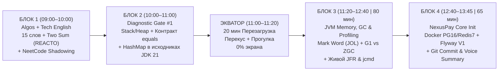

# ДЕНЬ 1 (Понедельник, Неделя 1): Расширенный Почасовой Боевой План (09:00 – 13:45 | 4 ч 45 мин)

> [!IMPORTANT]
> **Твой режим (Вариант Б — Полный без урезаний):** `09:00 – 13:45` (**4 часа 45 минут** = 4 глубоких рабочих блока + 20-минутный большой перерыв на экваторе в `11:00`).
> **Что дает расширение на +45 минут:**
> 1. Ты закрываешь **100% программы Понедельника без переносов на пятницу** — включая живую работу с **GC-логами (`-Xlog:gc*`)**, сравнение пауз **G1GC vs Generational ZGC**, диагностику через **`jcmd`** и снятие настоящего профиля **`JFR (Java Flight Recorder)`**.
> 2. В `11:00 – 11:20` у тебя есть полноценный **20-минутный перерыв на перезагрузку мозга и перекус**, благодаря чему во второй половине (`11:20 – 13:45`) концентрация останется такой же острой, как в 9 утра.

---

## ЧАСТЬ 1. Предстартовая подготовка («Нулевой блок» — Сегодня вечером, 25 минут)

Сделай эти 3 шага **сегодня вечером**, чтобы завтра в `09:00` стартовать за 0 секунд без ожидания скачивания Docker-образов и библиотек:

### Шаг 1. Проверка терминала и предзагрузка Docker-образов (5 мин)
Открой PowerShell и выполни:
```powershell
# 1. Проверь, что установлена Java 21 LTS (и доступны утилиты jcmd / jfr)
java -version
jcmd -l

# 2. Проверь, что Docker Desktop запущен
docker --version
docker compose version

# 3. Заранее скачай образы PostgreSQL 16 и Redis 7
docker pull postgres:16-alpine
docker pull redis:7-alpine
```

### Шаг 2. Генерация скелета `NexusPay` и индексация в IDE (10 мин)
1. Перейди на [https://start.spring.io](https://start.spring.io):
   * **Project:** Gradle - Groovy (или Maven)
   * **Language:** Java | **Java Version:** `21`
   * **Spring Boot:** `3.3.x` / `3.4.x` (последняя стабильная 3.x)
   * **Group:** `kz.iitu.nexuspay` | **Artifact:** `nexuspay`
   * **Dependencies:** `Spring Web`, `Spring Data JPA`, `Flyway Migration`, `PostgreSQL Driver`, `Spring Data Redis`, `Validation`, `Spring Boot Actuator`, `Testcontainers`.
2. Распакуй архив, открой проект в **IntelliJ IDEA** и дождись окончания скачивания всех зависимостей сегодня вечером.

### Шаг 3. Закрепи 5 рабочих вкладок на завтра (5 мин)
1. Задача: [LeetCode #1 — Two Sum](https://leetcode.com/problems/two-sum/)
2. Видео для Shadowing: [NeetCode — Two Sum (YouTube, 4:20)](https://www.youtube.com/watch?v=KLlXCFG5TnA)
3. Произношение терминов: [YouGlish.com](https://youglish.com)
4. Чтение по памяти JVM: [Aleksey Shipilëv — JVM Anatomy Quarks (Object Alignment & Mark Word)](https://shipilev.net/jvm/anatomy-quarks/)
5. Дока по ZGC: [OpenJDK JEP 439 — Generational ZGC](https://openjdk.org/jeps/439)

---

## ЧАСТЬ 2. Карта Тайминга Первого Дня (`09:00 – 13:45`)



| Время | Длительность | Блок | Главный результат на выходе (Definition of Done) |
| :--- | :--- | :--- | :--- |
| **`09:00 – 09:52`** | 52 мин | **БЛОК 1: Algos & Tech English** | Отработаны 15 слов, решена `Two Sum` вслух на EN по REACTO, сделано 3 прогона Shadowing с NeetCode. |
| **`09:52 – 10:00`** | 8 мин | *Микро-перерыв №1* | Вода, разминка шеи и плеч, взгляд в окно. |
| **`10:00 – 10:55`** | 55 мин | **БЛОК 2: Diagnostic Gate #1 & `HashMap`** | Написан тест памяти с нуля, разобран исходник `java.util.HashMap` в JDK 21, озвучен ответ на EN. |
| **`11:00 – 11:20`** | **20 мин** | **БОЛЬШОЙ ЭКВАТОР-ПЕРЕРЫВ** | Полный сброс когнитивной усталости, перекус, проветривание (телефон в руки не брать!). |
| **`11:20 – 12:30`** | 70 мин | **БЛОК 3 (Расширенный): JVM, `JOL`, GC & `JFR`** | Проверены байты `Mark Word` через `JOL`, сравнены логи `G1GC` и `ZGC`, снят и открыт профиль `.jfr` через `jcmd`. |
| **`12:30 – 12:40`** | 10 мин | *Микро-перерыв №2* | Отдых глаз и спины перед сборкой проекта. |
| **`12:40 – 13:45`** | 65 мин | **БЛОК 4: `NexusPay` Init + English Output** | Подняты `Postgres 16` и `Redis 7`, накачена миграция `Flyway V1`, сделан коммит и записано 60-сек голосовое в ТГ. |

---

## ЧАСТЬ 3. Поминутный План Действий по Блокам

---

### БЛОК 1 (`09:00 – 10:00`): Алгоритмический Дрилл + Разблокировка Речи (REACTO & Shadowing)

#### `09:00 – 09:12` (12 мин) | Фонетическая зачистка (Топ-15 слов, на которых срезаются с уровнем A2)
Произнеси каждое слово вслух **по 5 раз**, четко удерживая правильное ударение:
1. **`Thread`** — `[θred]` *(кончик языка между зубами, НЕ «трэд» и НЕ «срэд»)*
2. **`Cache`** — `[kæʃ]` *(читается точно как `cash` — наличные, НЕ «кэшэ»!)*
3. **`Queue`** — `[kjuː]` *(читается просто как английская буква «Q»)*
4. **`Schema`** — `[ˈskiːmə]` *(«скима» через звук К, НЕ «схема»)*
5. **`Null`** — `[nʌl]` *(«нал», НЕ «нуль»)*
6. **`Idempotent`** — `[ˌaɪdəmˈpoʊtənt]` *(«айдэм-поутэнт»)*
7. **`Asynchronous`** — `[eɪˈsɪŋkrənəs]` *(«эй-синкрэнэс», ударение на слог СИН)*
8. **`Latency`** — `[ˈleɪtənsi]` *(«лэйтэнси»)*
9. **`Throughput`** — `[ˈθruːpʊt]` *(«сру-пут» — пропускная способность)*
10. **`Deadlock`** — `[ˈdedlɒk]` *(«дэд-лок»)*
11. **`Query`** — `[ˈkwɪri]` *(«куири»)*
12. **`Integer`** — `[ˈɪntɪdʒər]` *(«интиджер» через ДЖ, НЕ «интегер»)*
13. **`Daemon`** — `[ˈdiːmən]` *(«димэн»)*
14. **`Height`** — `[haɪt]` *(«хайт», заканчивается на четкое Т)*
15. **`Determine`** — `[dɪˈtɜːrmɪn]` *(«дитёмин», НЕ «детермайн»)*

#### `09:12 – 09:37` (25 мин) | [LeetCode #1 — Two Sum](https://leetcode.com/problems/two-sum/) на Java 21 вслух по матрице REACTO
Открой задачу. **Главное правило: рот не закрывается ни на секунду.** Иди по этим 4 речевым блокам:

1. **R — Repeat & Clarify (Первая минута — вслух):**
   > *"So, we are given an array of integers `nums` and an integer `target`. We need to return the indices of the two numbers that add up to `target`, right? Let me check the edge cases: can the array contain negative numbers or duplicate values? And we can assume that exactly one valid answer exists."*
2. **E & A — Examples & Approach (Brute Force -> Optimal):**
   > *"First, a naive brute-force solution would use two nested loops to check every possible pair. That takes **Big O of N squared** ($O(N^2)$) time and **Big O of 1** ($O(1)$) space, which is too slow for large inputs.*
   > *We can optimize this down to **linear time, Big O of N** ($O(N)$), by trading space for time. As we iterate through the array once, we calculate `complement = target - nums[i]` and check if `complement` is already in our `HashMap`."*
3. **C — Code (Печатай код и комментируй каждую строчку вслух):**
   ```java
   class Solution {
       public int[] twoSum(int[] nums, int target) {
           // Here I initialize a HashMap to store each number and its index
           Map<Integer, Integer> seen = new HashMap<>();
           for (int i = 0; i < nums.length; i++) {
               int complement = target - nums[i];
               // HashMap lookup takes O(1) time on average
               if (seen.containsKey(complement)) {
                   return new int[]{seen.get(complement), i};
               }
               seen.put(nums[i], i);
           }
           throw new IllegalArgumentException("No match found");
       }
   }
   ```
4. **T & O — Dry-Run & Complexity:**
   > *"Let’s dry-run on `[2, 7, 11]` with target `9`. At index `0`, `complement` is `7`, not in map, so we store `2 -> 0`. At index `1`, `complement` is `2`, which is in the map! We return `[0, 1]`. Time complexity is **Big O of N** and space complexity is **Big O of N**."*

#### `09:37 – 09:52` (15 мин) | Моторный Shadowing ([NeetCode — Two Sum](https://www.youtube.com/watch?v=KLlXCFG5TnA))
Включи 4-минутный разбор NeetCode:
* **Прогон 1 (4.5 мин):** Слушаешь и повторяешь за ним вслух с задержкой в 0.5 секунды (тренировка слухо-моторной петли).
* **Прогон 2 (5 мин):** С английскими субтитрами, замечая его речевые связки (`Instead of doing that...`, `The easiest way to do this...`).
* **Прогон 3 (5 мин):** Говоришь синхронно с ним с полной артикуляцией.

#### `09:52 – 10:00` (8 мин) | Микро-перерыв №1
Встань из-за стола, выпей воды, посмотри вдаль.

---

### БЛОК 2 (`10:00 – 11:00`): Diagnostic Gate #1 + Внутреннее устройство `HashMap` (JDK 21)

#### `10:00 – 10:25` (25 мин) | Cold Blank-Sheet Dump (Без интернета, без ИИ, без подсказок!)
Открой пустой файл `diagnostic_week1.md` и за 25 минут выжми из памяти ответы на 5 вопросов базы 1–2 курса IITU:
1. **Stack vs Heap:** Что именно лежит в Thread Stack, а что в Heap? Где в памяти живет локальный `int x = 10` внутри метода, а где поле `int retryCount = 10` внутри объекта сервиса? Почему локальные переменные потокобезопасны?
2. **Контракт `equals()` и `hashCode()`:** Сформулируй 3 правила контракта. Опиши по шагам, что произойдет в памяти, если положить изменяемый объект `AccountKey` в `HashMap`, затем поменять его поле, участвующее в `hashCode()`, и вызвать `map.get(key)`.
3. **Устройство `HashMap` в Java 8–21:**
   * Зачем `HashMap.hash(key)` делает побитовый сдвиг и XOR: `(h = key.hashCode()) ^ (h >>> 16)`?
   * По какой побитовой формуле вычисляется индекс бакета и почему размер массива `table` всегда обязан быть степенью двойки ($16, 32, 64\dots$)?
   * Назови **оба** условия, при которых связный список в бакете превращается в красно-черное дерево (`TreeNode`).
4. **Java 21 ООП:** Чем `record` отличается от обычного класса на уровне байткода и памяти? Зачем нужны `sealed` классы/интерфейсы?
5. **Потоки ОС и Гонки:** Почему `count++` не атомарен (из каких 3 операций `Read-Modify-Write` он состоит на уровне регистров CPU)?

#### `10:25 – 10:55` (30 мин) | Сверка с эталоном (`Adversarial Diff`) + Чтение исходников `java.util.HashMap`
Открой в IntelliJ IDEA класс `java.util.HashMap` (`Ctrl+N` -> `HashMap`) и найди глазами:
* Строки констант:
  * `DEFAULT_INITIAL_CAPACITY = 1 << 4` (16)
  * `DEFAULT_LOAD_FACTOR = 0.75f` (ресайз происходит при заполнении $16 \times 0.75 = 12$ элементов)
  * `TREEIFY_THRESHOLD = 8`
  * `UNTREEIFY_THRESHOLD = 6`
  * **`MIN_TREEIFY_CAPACITY = 64`** *(Критическая деталь собеседований: если в одном бакете столкнулись 8 элементов, но размер массива `table.length < 64`, метод `treeifyBin()` НЕ строит красно-черное дерево, а вызывает `resize()`!)*
* Метод `static final int hash(Object key)`:
  ```java
  static final int hash(Object key) {
      int h;
      return (key == null) ? 0 : (h = key.hashCode()) ^ (h >>> 16);
  }
  ```
  *Зачем это нужно:* При маленькой таблице ($n = 16$) маска `n - 1` равна `0000...00001111` (учитываются только младшие 4 бита). Сдвиг `h >>> 16` и `XOR` подмешивают старшие 16 бит хэша в младшие, резко снижая число коллизий.
* **Озвучь вслух на английском (3 минуты, не подглядывая в текст):**
  > *"Under the hood, Java's `HashMap` uses an array of `Node` buckets. To find the bucket index, it mixes the upper 16 bits of the `hashCode` using XOR and applies a bitwise AND mask `(n - 1) & hash`. If a hash collision occurs, entries form a linked list. Once a bucket reaches 8 elements AND the total table capacity is at least 64, the list transforms into a Red-Black Tree, improving worst-case lookup from $O(N)$ to $O(\log N)$."*

#### `10:55 – 11:00` (5 мин) | Запись `[RED]`-зон в `diagnostic_week1.md`

---

### БОЛЬШОЙ ЭКВАТОР-ПЕРЕРЫВ (`11:00 – 11:20` | 20 минут)

> [!TIP]
> **Правило нейробиологии (Attention Residue Reset):** Позади 2 часа интенсивной работы. Закрой крышку ноутбука или выключи монитор на 20 минут. Съешь легкий белковый перекус, выпей стакан воды, выйди на балкон/улицу или сделай 10 минут NSDR (спокойного отдыха с закрытыми глазами). **Запрещено скроллить ленту в телефоне** — иначе мозг не отдохнет.

---

### БЛОК 3 — РАСШИРЕННЫЙ (`11:20 – 12:40` | 80 минут): Память JVM, `JOL`, Сборщики мусора (`G1GC` vs `ZGC`) и Живой Профайлинг (`jcmd` & `JFR`)

Благодаря расширенному расписанию мы разделяем этот блок на **3 четких этапа**: Теория (25 мин) -> Вскрытие байтов через `JOL` (20 мин) -> Живая диагностика `GC` и `JFR` (25 мин).

#### `11:20 – 11:45` (25 мин) | Теория: Object Header, порог 32 GB и `G1GC` vs `Generational ZGC`
Изучи материалы: [Shipilëv — JVM Anatomy Quarks](https://shipilev.net/jvm/anatomy-quarks/) + [JEP 439 (Generational ZGC)](https://openjdk.org/jeps/439).

1. **Анатомия объекта в куче (64-bit JVM с включенным `Compressed OOPs` по умолчанию до 32 GB):**
   * **`Mark Word` (8 байт):** Хранит `Identity HashCode` (31 бит, вычисляется лениво), возраст объекта `GC Age` (4 бита -> максимум **15** сборок мусора до промоушена в Old Gen) и биты состояния блокировки (`01` Unlocked, `00` Lightweight Lock, `10` Heavyweight Monitor ОС).
   * **`Klass Word` (4 байта с `CompressedClassPointers`):** Указатель на метаданные класса в `Metaspace`.
   * **Выравнивание (`Alignment Padding`):** Размер любого объекта в памяти JVM кратен **8 байтам**. Поэтому `new Object()` = `8B (Mark) + 4B (Klass) + 4B (Padding) = 16 байт`.
   * **Порог 32 GB (`Compressed OOPs`):** Обычная ссылка на 64-битной ОС весит 8 байт. Чтобы сэкономить память, JVM сжимает ссылки (`oop`) до **4 байт (32 бит)**. Так как адрес каждого объекта делится на 8 без остатка (младшие 3 бита всегда `000`), JVM хранит в 32 битах смещение в 8-байтных словах (`address >>> 3`). Это позволяет адресовать $2^{32} \times 8\text{ байт} = \mathbf{32\text{ GB}}$ кучи! При `-Xmx32g` и выше сжатие отключается, и ссылки начинают весить по 8 байт.
2. **Поколения Heap и Сборщики Мусора (Java 21):**
   * **Путь объекта:** Новые объекты аллоцируются в `Eden` (через быстрый поинтер-бампинг в `TLAB — Thread Local Allocation Buffer`, без блокировок между потоками!). Выжившие при Minor GC копируются между `Survivor S0` и `S1`, а после достижения порога возраста (`MaxTenuringThreshold`, макс. 15) переносятся в `Old Generation`.
   * **G1GC (дефолт в Java 21):** Куча разбита на ~2048 регионов (1–32 MB). Ссылки из `Old` в `Young` отслеживаются через `Card Table` (512-байтные ячейки) и `Remembered Sets (RSet)`. Если объект больше **50% размера региона**, он помечается как **Humongous** и выделяется сразу в непрерывных регионах Old Gen. Паузы `Stop-The-World` обычно `10–100 мс`.
   * **Generational ZGC (`-XX:+UseZGC -XX:+ZGenerational`):** Использует **Colored Pointers** (хранит биты состояния GC прямо внутри 64-битной ссылки) и **Load Barriers** (проверяет и чинит ссылку на лету при чтении поля). Перемещает объекты параллельно с работой приложения — паузы `Stop-The-World` держатся на уровне **`< 1 мс` (0.05–0.3 мс)** даже на терабайтных хипах!

#### `11:45 – 12:05` (20 мин) | Практика №1: Вскрытие памяти объекта через `JOL (Java Object Layout)`
В проекте `NexusPay` открой `build.gradle` и добавь в `dependencies`:
```groovy
testImplementation 'org.openjdk.jol:jol-core:0.17'
```
Создай тест `src/test/java/kz/iitu/nexuspay/JvmMemoryLayoutExperimentTest.java` и запусти его:
```java
package kz.iitu.nexuspay;

import org.junit.jupiter.api.Test;
import org.openjdk.jol.info.ClassLayout;
import org.openjdk.jol.vm.VM;

import java.math.BigDecimal;
import java.util.UUID;

class JvmMemoryLayoutExperimentTest {

    record AccountSnapshot(UUID id, BigDecimal balance, long version, boolean active) {}

    @Test
    void inspectObjectHeaderAndRecordLayout() {
        System.out.println("=== 1. JVM COMPRESSED OOPS DETAILS ===");
        System.out.println(VM.current().details());

        Object lock = new Object();
        System.out.println("=== 2. FRESH OBJECT (BEFORE HASHCODE) ===");
        System.out.println(ClassLayout.parseInstance(lock).toPrintable());

        int hash = System.identityHashCode(lock);
        System.out.println("=== 3. AFTER IDENTITY HASHCODE (0x" + Integer.toHexString(hash) + ") ===");
        System.out.println(ClassLayout.parseInstance(lock).toPrintable());

        synchronized (lock) {
            System.out.println("=== 4. INSIDE SYNCHRONIZED BLOCK (LOCKED MARK WORD) ===");
            System.out.println(ClassLayout.parseInstance(lock).toPrintable());
        }

        System.out.println("=== 5. JAVA 21 RECORD MEMORY LAYOUT ===");
        System.out.println(ClassLayout.parseClass(AccountSnapshot.class).toPrintable());
    }
}
```
Найди глазами в консоли:
1. В шаге 1: строчку `Compressed references (oops): 3-bit shift` (те самые $\times 8$ байт!).
2. В шаге 3: как твой hex-хэшкод прописался прямо в байты `Mark Word`.
3. В шаге 5: как JVM автоматически переставила поля внутри `AccountSnapshot` (`Field Reordering`: сначала `long`, потом `boolean`, потом 4-байтные `UUID`/`BigDecimal` ссылки), чтобы не терять байты на выравнивании!

#### `12:05 – 12:30` (25 мин) | Практика №2 (Расширенная): Сравнение `G1GC` vs `ZGC` логов и снятие `JFR` профиля через `jcmd`
Добавь в тот же тестовый файл (или отдельный класс `GcAndJfrExperiment.java`) метод, генерирующий волну аллокаций на 20 секунд:
```java
package kz.iitu.nexuspay;

import java.util.ArrayList;
import java.util.List;
import java.util.UUID;

public class GcAndJfrExperiment {
    // Кэш долгоживущих объектов (имитация Old Generation)
    private static final List<String> OLD_GEN_CACHE = new ArrayList<>();

    public static void main(String[] args) throws Exception {
        System.out.println("PID: " + ProcessHandle.current().pid());
        long end = System.currentTimeMillis() + 25_000; // 25 секунд работы
        int iteration = 0;

        while (System.currentTimeMillis() < end) {
            // Создаём короткоживущие объекты в Eden (умрут в Young GC)
            List<byte[]> shortLived = new ArrayList<>(1000);
            for (int i = 0; i < 1000; i++) {
                shortLived.add(new byte[1024]); // 1 KB
            }
            // Часть объектов выживает и переходит в Old Generation
            if (iteration++ % 20 == 0 && OLD_GEN_CACHE.size() < 50_000) {
                OLD_GEN_CACHE.add(UUID.randomUUID().toString());
            }
            Thread.sleep(10);
        }
        System.out.println("Experiment finished. Cache size: " + OLD_GEN_CACHE.size());
    }
}
```

Выполни **3 боевых упражнения инженера**:
1. **Запуск №1 — Чтение логов `G1GC` (7 мин):**
   В настройках запуска `GcAndJfrExperiment` в IDEA (`Modify Run Configuration -> Add VM options`) укажи:
   ```text
   -Xms128m -Xmx128m -XX:+UseG1GC -Xlog:gc*:stdout:time,uptime,level,tags
   ```
   Запусти и прочитай в консоли строчки: `Pause Young (Normal) (G1 Evacuation Pause) 64M->12M(128M) 2.45ms` — ты видишь, сколько мегабайт очистилось в `Eden/Survivor` и сколько миллисекунд длилась пауза `Stop-The-World`.
2. **Запуск №2 — Чтение логов `Generational ZGC` (7 мин):**
   Поменяй `VM options` на:
   ```text
   -Xms128m -Xmx128m -XX:+UseZGC -XX:+ZGenerational -Xlog:gc*:stdout:time,uptime,level,tags
   ```
   Запусти снова и сравни паузы: увидишь `Pause Mark Start 0.015ms` — пауза уменьшилась в **50–100 раз**!
3. **Запуск №3 — Снятие живого `JFR`-профиля и диагностика `jcmd` (11 мин):**
   Добавь в `VM options` автозапись профиля Java Flight Recorder:
   ```text
   -Xms128m -Xmx128m -XX:+UseG1GC -XX:StartFlightRecording=duration=20s,filename=day1_profile.jfr,settings=profile
   ```
   Пока программа работает 25 секунд, открой терминал PowerShell, возьми `PID` из первой строчки вывода и выполни:
   ```powershell
   jcmd <PID> GC.heap_info
   jcmd <PID> VM.flags
   ```
   Когда программа завершится, в корне проекта появится файл **`day1_profile.jfr`**. Перетащи его мышкой прямо в окно **IntelliJ IDEA** (или открой через `View -> Tool Windows -> Profiler -> Open JFR Snapshot`) — ты увидишь вкладки **Flame Graph (CPU)**, **Memory Allocations** (`byte[]` на первом месте!) и **Events / Garbage Collections**. Теперь на собеседовании ты сможешь уверенно сказать: *«Я профилировал приложения через JFR и `jcmd` и анализировал Flame Graphs аллокаций»*.

#### `12:30 – 12:40` (10 мин) | Микро-перерыв №2
Встань, разомнись, выпей воды перед сборкой `NexusPay`.

---

### БЛОК 4 (`12:40 – 13:45` | 65 минут): Запуск Киллер-Проекта №1 (`NexusPay`) & Финал Дня на Английском

#### `12:40 – 12:55` (15 мин) | Поднятие инфраструктуры в `docker-compose.yml`
Создай в корне проекта `NexusPay` файл `docker-compose.yml`:
```yaml
services:
  postgres:
    image: postgres:16-alpine
    container_name: nexuspay-postgres
    environment:
      POSTGRES_DB: nexuspay_db
      POSTGRES_USER: nexuspay_user
      POSTGRES_PASSWORD: nexuspay_secret_password
    ports:
      - "5432:5432"
    volumes:
      - pg_data:/var/lib/postgresql/data
    command: >
      postgres
      -c max_connections=200
      -c shared_buffers=256MB
      -c log_lock_waits=on
      -c deadlock_timeout=1s
    healthcheck:
      test: ["CMD-SHELL", "pg_isready -U nexuspay_user -d nexuspay_db"]
      interval: 5s
      timeout: 3s
      retries: 5

  redis:
    image: redis:7-alpine
    container_name: nexuspay-redis
    ports:
      - "6379:6379"
    command: redis-server --appendonly yes
    healthcheck:
      test: ["CMD", "redis-cli", "ping"]
      interval: 5s
      timeout: 3s
      retries: 5

volumes:
  pg_data:
```
Запусти контейнеры:
```powershell
docker compose up -d
docker compose ps
```
Убедись, что оба контейнера в статусе `Up (healthy)`.

#### `12:55 – 13:25` (30 мин) | Настройка `application.yml` и первой миграции Flyway `V1__init_ledger_schema.sql`

1. Настрой `src/main/resources/application.yml`:
   ```yaml
   spring:
     application:
       name: nexuspay-core
     threads:
       virtual:
         enabled: true # Включаем Virtual Threads (Java 21 Project Loom)
     datasource:
       url: jdbc:postgresql://localhost:5432/nexuspay_db
       username: nexuspay_user
       password: nexuspay_secret_password
       hikari:
         maximum-pool-size: 20
         minimum-idle: 5
         connection-timeout: 3000
     jpa:
       open-in-view: false # Отключаем OSIV анти-паттерн!
       hibernate:
         ddl-auto: validate # Схему БД меняет ТОЛЬКО Flyway!
       properties:
         hibernate:
           jdbc:
             time_zone: UTC
     flyway:
       enabled: true
       locations: classpath:db/migration
   ```

2. Создай файл `src/main/resources/db/migration/V1__init_ledger_schema.sql`:
   ```sql
   -- 1. Счета пользователей и мерчантов
   CREATE TABLE accounts (
       id              UUID PRIMARY KEY,
       owner_id        UUID NOT NULL,
       currency        VARCHAR(3) NOT NULL,
       balance         NUMERIC(19, 4) NOT NULL DEFAULT 0.0000,
       version         BIGINT NOT NULL DEFAULT 0,
       status          VARCHAR(20) NOT NULL DEFAULT 'ACTIVE',
       created_at      TIMESTAMPTZ NOT NULL DEFAULT NOW(),
       updated_at      TIMESTAMPTZ NOT NULL DEFAULT NOW(),
       CONSTRAINT chk_accounts_balance_non_negative CHECK (balance >= 0),
       CONSTRAINT chk_accounts_currency_len CHECK (char_length(currency) = 3)
   );

   CREATE INDEX idx_accounts_owner_id ON accounts (owner_id);

   -- 2. Транзакции переводов (с поддержкой Idempotency-Key)
   CREATE TABLE transfers (
       id              UUID PRIMARY KEY,
       idempotency_key VARCHAR(128) NOT NULL,
       from_account_id UUID NOT NULL REFERENCES accounts (id),
       to_account_id   UUID NOT NULL REFERENCES accounts (id),
       amount          NUMERIC(19, 4) NOT NULL,
       currency        VARCHAR(3) NOT NULL,
       status          VARCHAR(20) NOT NULL,
       created_at      TIMESTAMPTZ NOT NULL DEFAULT NOW(),
       CONSTRAINT uq_transfers_idempotency_key UNIQUE (idempotency_key),
       CONSTRAINT chk_transfers_amount_positive CHECK (amount > 0),
       CONSTRAINT chk_transfers_different_accounts CHECK (from_account_id <> to_account_id)
   );

   CREATE INDEX idx_transfers_from_account_created ON transfers (from_account_id, created_at DESC);
   CREATE INDEX idx_transfers_to_account_created ON transfers (to_account_id, created_at DESC);

   -- 3. Неизменяемый журнал двойной записи (Double-Entry Ledger)
   CREATE TABLE ledger_entries (
       id              BIGSERIAL PRIMARY KEY,
       transfer_id     UUID NOT NULL REFERENCES transfers (id),
       account_id      UUID NOT NULL REFERENCES accounts (id),
       direction       VARCHAR(6) NOT NULL, -- 'DEBIT' или 'CREDIT'
       amount          NUMERIC(19, 4) NOT NULL, -- отрицательное для DEBIT, положительное для CREDIT
       created_at      TIMESTAMPTZ NOT NULL DEFAULT NOW(),
       CONSTRAINT chk_ledger_direction CHECK (direction IN ('DEBIT', 'CREDIT'))
   );

   CREATE INDEX idx_ledger_entries_account_created ON ledger_entries (account_id, created_at DESC);
   CREATE INDEX idx_ledger_entries_transfer_id ON ledger_entries (transfer_id);
   ```

3. Запусти `NexuspayApplication` в IDEA и проверь в терминале, что таблицы реально созданы в контейнере PostgreSQL:
   ```powershell
   docker exec -it nexuspay-postgres psql -U nexuspay_user -d nexuspay_db -c "\dt"
   ```
   В ответе увидишь 4 таблицы: `accounts`, `transfers`, `ledger_entries` и `flyway_schema_history`.

#### `13:25 – 13:45` (20 мин) | Финал Дня 1: Git Commit + Feynman Log + Anki + 60-Second Voice Summary
1. **Git Commit на английском (4 мин):**
   *(Не забудь добавить `*.jfr` в `.gitignore`, чтобы не коммитить бинарный дамп профайлера!)*
   ```powershell
   git add .
   git commit -m "feat(ledger): bootstrap NexusPay with Postgres 16, Redis 7 and Flyway V1 double-entry schema"
   ```
2. **Добавление 6 Cloze-карточек в Anki + Feynman Log (8 мин):**
   * Карточка 1: `In a Java HashMap, a bucket converts from a linked list into a Red-Black Tree when {{c1::the bucket size reaches 8 AND the total table capacity is at least 64}}.`
   * Карточка 2: `On a 64-bit JVM with Compressed OOPs, the Object Header takes {{c1::12 bytes (8-byte Mark Word + 4-byte Klass Word)}}, and empty Object size is padded to {{c2::16 bytes}}.`
   * Карточка 3: `Compressed OOPs stop working when the JVM Heap exceeds {{c1::32 GB}} because 32-bit references shift addresses by {{c2::8-byte alignment}}.`
   * Карточка 4: `Unlike G1GC, Generational ZGC achieves sub-millisecond pause times (< 1 ms) by using {{c1::Colored Pointers}} and {{c2::Load Barriers}} to relocate objects concurrently.`
   * Карточка 5: `In Spring Boot, we set {{c1::spring.jpa.open-in-view=false}} to prevent holding database connections open during HTTP view rendering.`
   * Карточка 6: `To capture a low-overhead production CPU and allocation profile on a running JVM, we use {{c1::Java Flight Recorder (JFR)}} triggered via {{c2::jcmd <PID> JFR.start}}.`
3. **Голосовой чекпоинт в Telegram (8 мин — `Saved Messages`):**
   Открой Telegram и **без чтения с листа** запиши 60-секундное голосовое сообщение на английском по итогам дня:
   > *"Hi! Today was Day 1 of my backend intensive. First, I solved the Two Sum problem on LeetCode in Java 21 using a HashMap in O(N) time while commenting my code out loud. Second, I inspected `HashMap` internals in JDK 21 and used the JOL library to examine the 16-byte JVM Object Header, including the Mark Word and lock bits. Third, I ran a memory allocation benchmark comparing G1GC and Generational ZGC logs and captured a JFR profile using `jcmd`. Finally, I bootstrapped my fintech project NexusPay with Spring Boot 3, Docker Compose for PostgreSQL 16 and Redis 7, and applied the Flyway V1 migration for our double-entry ledger."*

---

## Чек-лист победы Первого Дня (Отметь завтра в 13:45)
- [ ] **09:00–10:00:** Отработал вслух 15 слов фонетического черного списка, решил `Two Sum` по схеме REACTO и сделал 3 прогона Shadowing с NeetCode.
- [ ] **10:00–11:00:** Написал `Diagnostic Gate #1` с чистого листа и проверил исходники `java.util.HashMap` в JDK 21 (`TREEIFY_THRESHOLD = 8` + `MIN_TREEIFY_CAPACITY = 64`).
- [ ] **11:00–11:20:** Сделал полноценный 20-минутный перерыв без экрана и телефона.
- [ ] **11:20–12:40:** Вскрыл `Mark Word` через `JOL`, сравнил GC-логи `G1GC` и `Generational ZGC`, снял и открыл `.jfr` профиль в IDEA.
- [ ] **12:40–13:45:** Поднял `PostgreSQL 16` + `Redis 7` в Docker Compose, накатил `V1__init_ledger_schema.sql` через Flyway, сделал коммит и записал 60-секундное голосовое в Telegram на английском.
