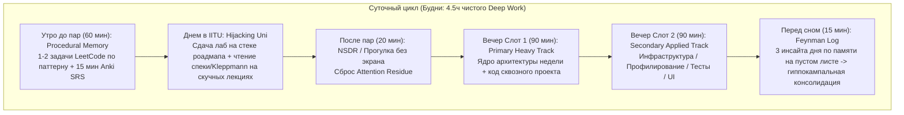
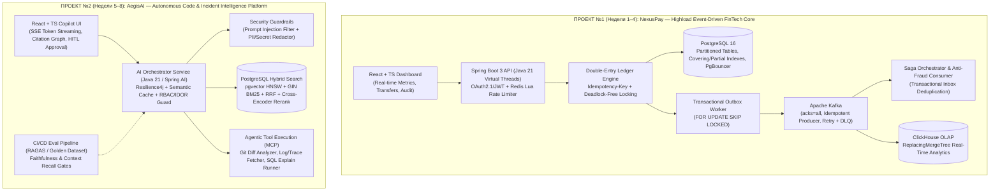

# Персональный 8-недельный Ultralearning Roadmap: От 3 курса IITU (МУИТ) до Strong Junior / AI-Augmented Engineer (2026–2027)

> [!IMPORTANT]
> **Твоя точка старта (Профиль):** Студент 3 курса IITU (МУИТ, Алматы). Основной промышленный стек: **Java 21 LTS + Spring Boot 3.x + PostgreSQL + React (Vite/TS) + Docker/Kafka/Redis + Production AI Engineering**.
> **Главная цель на 8 недель (60 дней):** Не переучивать базу 1–2 курса с нуля, а перевести её в боевой режим через стресс-тесты припоминания (`Diagnostic Recall`), параллельно освоив **100% проми-стека 2026–2027** и собрав **2 эталонных сквозных пет-проекта**, которые закроют и защиты РК1/РК2/Final в МУИТ, и техсобесы в Kaspi, Kolesa, Halyk, Freedom, inDrive и BigTech СНГ.

---

## ЧАСТЬ 1. Аудит программы IITU (1–3 курс) и Рынка Труда (КЗ + СНГ + Мир)

### 1.1. Что у тебя УЖЕ есть после 1–2 курса IITU (База — НЕ УЧИТЬ ЗАНОВО, только вспоминать)

В МУИТ на 1–2 курсах (семестры 1–4) ты уже прошел фундамент. **Правило роадмапа: 0 часов на повторное чтение вводных лекций по этим предметам.** Вместо этого используется протокол **Pre-Test → Diff → Surgical Drill (45 мин в начале недели)**.

| Дисциплина IITU (1–2 курс) | Что уже в памяти (Storage Strength есть) | Что нужно «вытащить» и докрутить до Senior-интервью (Delta-Learning) |
| :--- | :--- | :--- |
| **Intro to Programming (C++) & OOP (Java)** | Синтаксис, циклы, указатели, классы, наследование, полиморфизм, `ArrayList`, `HashMap`, `try-catch`. | Устройство памяти JVM, Mark Word, контракты `equals/hashCode` при мутации ключа, устройство `HashMap` / `ConcurrentHashMap` (CAS + synchronized + Red-Black Tree), Java 21 `record`, `sealed`, Virtual Threads. |
| **Algorithms & Data Structures (ADS)** | Оценка $O(N)$, базовые сортировки, стек, очередь, связный список, BST, простые графы (BFS/DFS). | Паттерны решения задач на скорость (Two Pointers, Sliding Window, Monotonic Stack, Binary Search on Answer, Heap/PriorityQueue, Topological Sort, DP) — по 1–2 задачи каждое утро. |
| **Database Management Systems (DBMS)** | ER-диаграммы, 1NF–3NF, базовый `SELECT`, `JOIN`, `GROUP BY`, простые индексы. | Внутренности PostgreSQL: страницы 8KB, TOAST, WAL, MVCC (`xmin`/`xmax`/`ctid`), `VACUUM` и Bloat, уровни изоляции + Lost Update / Write Skew, индексы B-Tree (Covering/Partial), GIN, GiST, BRIN, `pgvector`, чтение `EXPLAIN (ANALYZE, BUFFERS)`. |
| **Computer Networks (Cisco CCNA 1–2)** | Модель OSI, TCP/IP L2–L4, IP-адресация, маски, маршрутизация, VLAN, DNS, DHCP. | Прикладной L4–L7 для бэкендера: TCP 3-way handshake, `TIME_WAIT`, `somaxconn`, TLS 1.3 handshake, HTTP/1.1 vs HTTP/2 (мультиплексирование) vs HTTP/3 (QUIC), gRPC (Protobuf), SSE, WebSockets, CORS. |
| **Computer Architecture & OS (Red Hat Linux)** | Регистры, кэш CPU, теория процессов и потоков, базовые команды Linux CLI, права `chmod`. | Linux syscalls (`strace`), виртуальная память и Page Faults, файловые дескрипторы, модели ввода-вывода (`blocking`, `non-blocking`, **`epoll`** Edge vs Level Triggered, `Zero-Copy sendfile`), `cgroups v2` и `namespaces` (основа Docker). |
| **Web Technologies & Math (LinAlg, ProbStat)** | HTML/CSS/JS, DOM, Fetch API, матрицы, векторы, вероятности. | Строгий React + TypeScript (Vite), кастомные хуки и обработка состояний; косинусное сходство векторов (база для Embeddings и Vector Search в AI). |

---

### 1.2. Как «хакнуть» 3 курс IITU (Принцип 100% синергии)

На 3 курсе МУИТ (семестры 5–6) идут **Java Enterprise (Spring/Hibernate)**, **Software Engineering (UML, GoF, архитектура)**, **Frontend (React)**, **ML / Python**.
**Где ловушка:** 90% студентов делают для РК1/РК2/Final игрушечные CRUD-проекты на `localhost` без Docker, без миграций и без тестов, тратя время впустую.
**Твой ход:** Оба твоих пет-проекта из этого роадмапа **одновременно сдаются в МУИТ** как курсовые/лабораторные по Java Enterprise, Software Engineering, БД и AI/ML. Ты убиваешь двух зайцев одним выстрелом.

---

### 1.3. Срез рынка труда 2026–2027 (Алматы / Астана / СНГ / Global)

| Работодатель | Программа / Вход | Главный стек и на что смотрят на техсобесе |
| :--- | :--- | :--- |
| **Kaspi.kz** (Алматы) | **Kaspi Lab** + прямой найм в команды | **Java 21 / Spring Boot**, **.NET Core**, **Go**, **Python (AI)**. Kafka, Redis, ClickHouse, MS SQL / Postgres, K8s. Жестко спрашивают **SQL (оконные функции, индексы, блокировки)**, многопоточность, отказоустойчивость под Highload и алгоритмы. |
| **Halyk Bank** (Алматы/Астана) | **Halyk Start / Academy** | **Java 17/21 + Spring Boot 3**, **Go**, PostgreSQL, Oracle, **Kafka**, OpenShift/K8s, OAuth2/OIDC. Глубоко гоняют по **Java Core, JMM, Spring Proxies, `@Transactional`, Hibernate N+1 и микросервисным паттернам (Outbox, Saga)**. |
| **Kolesa Group** (Алматы) | **Kolesa Academy / Upgrade** | **Go**, PHP, Python, **React/TS**, PostgreSQL, Redis, RabbitMQ/Kafka, Docker. Огромный фокус на понимание устройства веба (HTTP, сети), чистую архитектуру, тестирование и адекватные **soft skills** (умение объяснять свои решения). |
| **Freedom Holding** (Экосистема) | Стажировки **Freedom** (Bank, Broker, Lifestyle) | **Java (Spring Boot)**, **Go**, **Python (FastAPI)**, **React/TS**, PostgreSQL, ClickHouse, Kafka, Redis. Ценят инженерную самостоятельность, умение интегрировать сложные API, идемпотентность платежей и рабочие пет-проекты в Docker. |
| **Jusan Tech / Alatau City Bank** | **Jusan Singularity** | **Java (Spring Boot)**, **Go**, **React/TS**, Mobile. Алгоритмический отбор + глубокий буткемп по промышленной разработке (Git-flow, CI/CD, Docker, безопасность, БД). |
| **inDrive / Beeline (QazCode) / BTS Digital** | Стажировки & Junior+ | **Go, Java, Python (FastAPI + LLM/RAG)**. В **inDrive** — алгоритмы уровня LeetCode Medium + System Design + английский. В **QazCode (Beeline)** и **BTS** — сильный спрос на стык **Backend + Production AI / LLM / RAG**. |
| **BigTech СНГ (Яндекс, Т-Банк, Ozon, Avito)** | Стажировки и Junior+ (удаленно/офис) | **Секции отбора:** 1) Алгоритмы (2 задачи за 45–60 мин), 2) Платформа и язык (JVM, Concurrency, Spring, память), 3) **Code Review / Debugging** (найти баги гонки и транзакций в чужом коде), 4) **Architecture & DB Design** (спроектировать сервис с кэшем, очередями и БД). |

---

## ЧАСТЬ 2. Когнитивная инженерия роадмапа (Как вывезти всё за 2 месяца и не сгореть)

Чтобы совместить **5 тяжелых треков** (`Backend/JVM`, `DB/Highload`, `Distributed/Infra`, `AI Engineering`, `Algorithms + Frontend`) параллельно с парами в IITU:

### 4 золотых правила твоей когнитивной системы:
1. **Запрет на пассивное чтение базы (Протокол `Pre-Test → Diff → Surgical Drill`):**
   Каждый понедельник начинается с **45-минутного Diagnostic Gate**. Ты открываешь пустой `.md` файл и без интернета отвечаешь на каверзные вопросы по базе 1–2 курса IITU. Всё, что ответил (`[GREEN]`) — пропускаешь. Читаешь документацию **только** по тому, где поплыл (`[RED]`), и сразу проверяешь в коде/терминале.
2. **Когнитивная ортогональность (Orthogonal Interleaving):**
   Никогда не ставь два тяжелых теоретических блока в один вечер. Формула дня:
   * **Утро (процедурная память):** Алгоритмы + SQL-разминка.
   * **Вечер Блок 1 (высокий Intrinsic Load):** Основной системный трек недели (например, JVM Concurrency или Postgres MVCC) — сразу в код проекта.
   * **Вечер Блок 2 (прикладной/инструментальный трек):** Docker, Testcontainers, Prometheus/Grafana, React UI или настройка CI/CD.
3. **Принцип Единого Сквозного Скелета (Unified Project Spine):**
   Ты не делаешь 20 мелких забываемых туториалов. Все 8 недель ты строишь **2 связанных промышленных проекта** (Недели 1–4 и Недели 5–8). Каждая новая тема — это не абстрактный конспект, а новый PR/модуль в твой репозиторий.
4. **Субботняя защита по Фейнману и Воскресный офлайн:**
   * В **пятницу** — ноль новой теории, только интеграция и стресс-тесты (`k6`, `Testcontainers`).
   * В **субботу** — закрытие фичи + **15-минутная устная защита архитектуры вслух** (отвечаешь на вопрос: *«Что упадет первым при 5000 RPS и как я это починил?»*).
   * В **воскресенье после 14:00** — полный запрет на код. Мозг должен консолидировать нейронные связи, иначе на 4-й неделе наступит дофаминовая яма.

---

## ЧАСТЬ 3. Архитектура твоих 2 Киллер-Пет-Проектов (Уровень Strong Junior / Pre-Middle)

Эти два проекта спроектированы так, чтобы покрыть **абсолютно каждую строчку требований** рынка 2026–2027 и впечатлить любого техлида на код-ревью.

### Почему эти 2 проекта взрывают шаблоны рекрутеров и техлидов:
1. **Проект №1 (`NexusPay` — Недели 1–4):** Доказывает, что ты понимаешь деньги, транзакции, многопоточность, блокировки БД, идемпотентность, брокеры сообщений (Kafka), Outbox/Saga, колоночную аналитику (ClickHouse) и нагрузочное тестирование (`k6` + Grafana). Это 100% попадание в **Kaspi, Halyk, Freedom, Jusan, Т-Банк, Яндекс**.
2. **Проект №2 (`AegisAI` — Недели 5–8):** Доказывает, что ты не просто дергаешь `ChatGPT API`, а умеешь строить **инженерные AI-системы**: AST/Parent-Child чанкинг, гибридный поиск (`pgvector HNSW` + полнотекстовый `GIN BM25` + `Reciprocal Rank Fusion` + реранкер), графы агентов с вызовом инструментов (`Tool Calling / MCP`), стриминг по `SSE`, семантический кэш в Redis, защиту от Prompt Injection и автоматическую оценку качества (`RAGAS Evals`) в CI/CD.

---

## ЧАСТЬ 4. Полная матрица всех тем и подтем (Чек-лист рынка 2026–2027)

Перед тем как перейти к понедельному плану, вот **исчерпывающий реестр микро-тем**, которые вшиты в твои 8 недель:

### Трек 1: Java 21 LTS, JVM Internals & Concurrency
- [ ] **Память JVM:** Heap (Eden, S0/S1, Old, Humongous regions), Stack, Metaspace, Off-Heap (`DirectByteBuffer`), Object Header (`Mark Word` — блокировки/хэшкод/возраст + `Klass Word`), Compressed OOPs (порог 32 GB).
- [ ] **Garbage Collectors:** G1GC (Remembered Sets, Card Table, SATB, Mixed GC) vs Generational ZGC (Colored Pointers, Load Barriers, паузы < 1 мс). Снятие Heap Dump (`jmap`), профилирование JFR / Async-Profiler (Flame Graphs).
- [ ] **Java Memory Model (JMM):** CPU Caches (L1/L2/L3), Cache Line (64B), False Sharing (`@Contended`), Store Buffer, Memory Barriers, правила **Happens-Before**, `volatile` vs атомики (`VarHandle` / CAS).
- [ ] **Многопоточность & Java 21:** уcтройство `synchronized` (Biased/Lightweight/Heavyweight monitor) vs `ReentrantLock` (`AQS` — CLH queue + CAS + `LockSupport.park`), `ReadWriteLock`, `StampedLock`.
- [ ] **Virtual Threads (Project Loom):** Carrier Threads (`ForkJoinPool`), Continuations (монтирование стека в Heap), **проблема Pinning** (`synchronized` с I/O или JNI), `StructuredTaskScope`, `ScopedValue` вместо `ThreadLocal`.
- [ ] **Concurrent-коллекции:** `ConcurrentHashMap` (устройство бакетов, дерево при >8, `CounterCell`), `CopyOnWriteArrayList`, `BlockingQueue`, `CompletableFuture` (цепочки, экзекуторы, обработка ошибок).

### Трек 2: Spring Boot 3.x & JPA / Hibernate Internals
- [ ] **Spring Core:** Жизненный цикл бина (`BeanDefinition` -> `BeanFactoryPostProcessor` -> Конструктор -> DI -> **`BeanPostProcessor`**, где в `postProcessAfterInitialization` создаются прокси).
- [ ] **Прокси и АОП:** JDK Dynamic Proxy (по интерфейсу) vs CGLIB (наследование класса). Почему **self-invocation** (`this.method()`) ломает `@Transactional`, `@Async`, `@Cacheable`.
- [ ] **Транзакции в Spring:** `PlatformTransactionManager`, привязка коннекта к `ThreadLocal`, уровни **Propagation** (`REQUIRED`, ловушка исчерпания пула соединений при `REQUIRES_NEW`, `NESTED` на Savepoints), `rollbackFor = Exception.class`. Почему нельзя делать HTTP-вызовы и отправку в Kafka внутри `@Transactional`.
- [ ] **Hibernate / JPA под капотом:** 1st Level Cache (Persistence Context), механизм **Dirty Checking** (снапшоты сущностей и почему `@Transactional(readOnly = true)` ускоряет чтение и экономит память), `flush()` режимы.
- [ ] **Проблема N+1 и пагинация:** решение через `JOIN FETCH`, `@EntityGraph`, `@BatchSize`, DTO Record Projections. **Критическая ловушка `HHH90003004`:** почему `JOIN FETCH` коллекций (`OneToMany`) вместе с `Pageable` грузит всю таблицу в память JVM (OOM) и как чинить двухшаговым запросом с ID.
- [ ] **Блокировки и Пул соединений:** Оптимистичная (`@Version`) vs Пессимистичная (`PESSIMISTIC_WRITE` / `FOR UPDATE SKIP LOCKED`). Формула сайзинга **HikariCP** (`connections = cores * 2 + spindles`), `leakDetectionThreshold`. Централизованная обработка ошибок через **RFC 7807 (`ProblemDetail`)**.

### Трек 3: PostgreSQL Internals, Highload DB, Redis, Kafka, ClickHouse
- [ ] **Хранение в PostgreSQL:** 8 KB страницы (Page Header, ItemId, Tuples), **TOAST** (сжатие и вынос полей >2 KB), Shared Buffers, **WAL (Write-Ahead Log)**, `fsync`, Checkpointer.
- [ ] **MVCC & Vacuum:** скрытые поля `xmin`, `xmax`, `ctid`. Почему `UPDATE` = `DELETE + INSERT`. Видимость снапшотов. Dead Tuples, Table/Index Bloat, **HOT-updates** (`fillfactor`), Autovacuum тюнинг, **Transaction ID Wraparound** (`VACUUM FREEZE`).
- [ ] **Изоляция и Аномалии:** `Read Committed` (дефолт в PG), `Repeatable Read` (Snapshot Isolation в PG — нет фантомов, но есть **Write Skew!**), `Serializable` (SSI). Как возникает **Lost Update** на `Read Committed` и 3 способа защиты (`UPDATE x = x - 1`, `SELECT FOR UPDATE`, Optimistic `@Version`).
- [ ] **Индексы и Планировщик:**
  - **B-Tree:** составные индексы (правило левого префикса, порядок `Equality -> Sort/Range`), **Covering Index** (`INCLUDE` -> Index-Only Scan + Visibility Map), **Partial Index** (`WHERE status = 'ACTIVE'`).
  - **GIN** (JSONB `@>`, полнотекстовый поиск `tsvector`, `fastupdate`), **GiST** (геоданные, диапазоны, Exclusion Constraints), **BRIN** (минимакс по блокам для тайм-серий), **pgvector** (**HNSW** vs IVFFlat).
  - Чтение **`EXPLAIN (ANALYZE, BUFFERS)`**: `Seq Scan`, `Index Scan`, `Bitmap Heap Scan` (`lossy` блоки при нехватке `work_mem`), алгоритмы **Nested Loop**, **Hash Join** (spill to disk), **Merge Join**.
- [ ] **Масштабирование БД:** Декларативное партиционирование (`RANGE`, `HASH`, Partition Pruning), физическая (Streaming WAL) vs логическая репликация (Debezium CDC), **PgBouncer** (Transaction pooling mode).
- [ ] **Redis:** Event Loop, SDS/SkipList, RDB vs AOF. Паттерны кэша (Cache-Aside, Write-Behind). Защита от **Cache Stampede** (Singleflight / Distributed Lock / PER), **Cache Penetration** (Bloom Filter / null-cache), **Cache Avalanche** (TTL Jitter). Атомарные **Lua-скрипты**.
- [ ] **Apache Kafka:** Топики, **Партиции** (гарантия порядка и предел параллелизма внутри одной Consumer Group), сегменты, **Zero-Copy (`sendfile`)**. Продюсер (`acks=all`, `min.insync.replicas=2`, `enable.idempotence=true`), Консьюмер (Rebalance протоколы, `max.poll.interval.ms`, ручной коммит, **Retry Topics + DLQ**).
- [ ] **ClickHouse (OLAP):** Колоночное хранение, SIMD векторизация, сжатие, движки **`MergeTree` / `ReplacingMergeTree`** (дедупликация в фоне, `FINAL`, `argMax`), Sparse Primary Index (`index_granularity = 8192`), запрет на точечные мутации (запись только батчами).

### Трек 4: Distributed Systems, DevOps, Observability & Security
- [ ] **Надежность распределенных систем:**
  - **Idempotency-Key:** стейт-машина (`IN_PROGRESS`, `COMPLETED`, `FAILED`), хранение хэша payload, атомарный перехват.
  - **Проблема Dual-Write:** почему нельзя писать в БД и в Kafka без координации. **Transactional Outbox** (`FOR UPDATE SKIP LOCKED` / CDC) + **Transactional Inbox** (дедупликация `processed_events` для Effectively-Once).
  - **Saga Pattern:** Orchestration vs Choreography, компенсирующие транзакции, семантические холды.
  - **Resilience4j:** Circuit Breaker, Retry с Exponential Backoff + **Full Jitter**, Rate Limiter (Token Bucket / Sliding Window), Bulkhead, Timeouts.
  - **Distributed Locks:** Redis Lock с Lua-удалением, проблема GC-пауз, **Fencing Tokens**, Postgres **Advisory Locks** (`pg_try_advisory_xact_lock`).
- [ ] **Observability (Наблюдаемость):**
  - Структурированные JSON-логи с `trace_id`/`span_id` (MDC).
  - Метрики **Micrometer + Prometheus + Grafana:** `Counter`, `Gauge`, `Histogram`, расчет перцентилей **p95 / p99** (`histogram_quantile`), метод RED/USE, запрет на High Cardinality метки.
  - Распределенный трейсинг **OpenTelemetry + Jaeger/Tempo:** проброс `traceparent` через HTTP и Kafka headers.
- [ ] **Linux, Docker, K8s & CI/CD:**
  - Диагностика Linux за 60 секунд (`vmstat`, `iostat`, `pidstat`, `ss -tulnp`, `strace`).
  - **Multi-stage non-root Dockerfile**, лимиты памяти JVM в контейнере (`-XX:MaxRAMPercentage=75.0`, причина `OOMKilled 137`).
  - **Kubernetes:** Deployment, Service, Ingress, ConfigMap/Secret, Requests/Limits. **Пробы:** `startupProbe`, `readinessProbe`, `livenessProbe` (**почему в liveness нельзя проверять БД!**), **Graceful Shutdown** (`SIGTERM`).
  - Интеграционное тестирование на **Testcontainers** (Postgres, Redis, Kafka) в GitHub Actions.
- [ ] **Security (SecDevOps):** **OAuth 2.1 + PKCE**, Access JWT (проверка подписи, `exp`, `aud`, `iss`, JWKS) + Refresh Token (ротация, `HttpOnly, Secure, SameSite=Strict`), пароли **Argon2id**, защита от **IDOR/BOLA** (проверка владельца ресурса в SQL), SQLi в динамическом `ORDER BY`, SSRF, XSS, CSRF.

### Трек 5: AI Engineering & Frontend Integration (React + TS)
- [ ] **Production RAG:** парсинг документов и AST-чанкинг кода, **Parent-Child (Small-to-Big) Retrieval**, эмбеддинги, **Hybrid Search в Postgres** (`pgvector HNSW` + `GIN tsvector BM25` + слияние рангов **RRF — Reciprocal Rank Fusion** + **Cross-Encoder Reranker**), Query Transformation (HyDE, Multi-Query).
- [ ] **AI Agents & Reliability:** **Structured Outputs** (JSON Schema -> Java `record`), безопасный **Tool Calling (Function Calling) & MCP**, граф состояний агента (Router -> Planner -> Executor -> Critic/Verifier), **Human-in-the-Loop (HITL)** перед опасными операциями.
- [ ] **Latency, Cost & Evals:** стриминг ответа через **SSE (Server-Sent Events)**, **Semantic Caching** в Redis/pgvector, Model Routing & Fallbacks, защита от **Prompt Injection / Indirect Prompt Injection**, маскирование **PII/секретов**, автоматический пайплайн оценки качества **RAGAS / DeepEval** (`Faithfulness`, `Answer Relevance`, `Context Recall/Precision`) на Golden Dataset в CI/CD.
- [ ] **React + Vite + TypeScript:** строгая типизация пропсов и API-ответов, централизованный API-клиент, кастомные хуки для SSE-стриминга токенов и отображения метрик/трейсов, чистые состояния `loading / error / empty`.

---

## ЧАСТЬ 5. Понедельный и Посуточный План на 8 Недель (2 Месяца)

---

### МЕСЯЦ 1 (Недели 1–4): Backend Internals, Highload DB, Distributed Systems & Проект №1 (`NexusPay`)

---

#### НЕДЕЛЯ 1: JVM Internals, Java 21 Concurrency, Spring Core & Ядро двойной записи (`NexusPay`)
* **Primary Track (Вечер 1):** Java 21, JMM, Многопоточность, Spring Core & Transaction Internals.
* **Secondary Track (Вечер 2):** Docker Multi-stage, Testcontainers, Flyway, базовый скелет `NexusPay`.
* **Утренний Дрилл (60 мин/день):** LeetCode: *Arrays & Hashing + Two Pointers* (7 задач: `Two Sum`, `Group Anagrams`, `Top K Frequent Elements`, `Product of Array Except Self`, `Subarray Sum Equals K`, `3Sum`, `Container With Most Water`).

| День | Утро (60 мин) | Вечер Блок 1 — Primary (90 мин) | Вечер Блок 2 — Secondary & Code (90 мин) |
| :--- | :--- | :--- | :--- |
| **Пн** | **Diagnostic Gate #1 (45m):** Память (Stack/Heap), ООП, устройство `HashMap`, базовые потоки. Разбор `[RED]` зон + 1 задача LeetCode. | **JVM Memory & GC:** Object Header (Mark Word, Klass Word, Compressed OOPs), поколения Heap, G1GC vs Generational ZGC, чтение GC логов и снятие JFR-профиля. | Инициализация монорепозитория `NexusPay` (Java 21, Spring Boot 3.3+, Gradle/Maven). Поднятие `docker-compose.yml` (PostgreSQL 16, Redis 7). Настройка **Flyway** миграций (`V1__init_ledger_schema.sql`). |
| **Вт** | LeetCode (`Group Anagrams`, `Top K Frequent`) + Anki (Mark Word, ZGC). | **JMM & Locks:** CPU Cache Lines, False Sharing, правила **Happens-Before**, `volatile`, CAS, устройство **`AQS`** (`ReentrantLock` vs `synchronized`), `ConcurrentHashMap` под капотом. | Проектирование схемы **Double-Entry Bookkeeping**: таблицы `accounts`, `transfers`, `ledger_entries` (`BIGINT`/`UUID`, `TIMESTAMPTZ`, `snake_case`, `CHECK (balance >= 0)`). |
| **Ср** | LeetCode (`Product of Array`, `Subarray Sum Equals K`) + Anki. | **Java 21 Project Loom:** Virtual Threads, Carrier Threads, Continuations, **ловушка Pinning** (`synchronized` vs `ReentrantLock`), `StructuredTaskScope`, `ScopedValue`. | Включение Virtual Threads в Spring Boot 3. Реализация сервиса переводов между счетами. Защита от **Deadlock** через строгую сортировку ID счетов (`firstLockId = min(from, to)`) перед `SELECT ... FOR UPDATE`. |
| **Чт** | LeetCode (`3Sum`) + SQL разминка (`JOIN` + `GROUP BY`). | **Spring Core & `@Transactional` под капотом:** Жизненный цикл бина, `BeanPostProcessor`, JDK Proxy vs CGLIB, проблема **self-invocation**, уровни Propagation (`REQUIRED` vs `REQUIRES_NEW` deadlock пула). | Реализация REST API (`Controller -> Service -> Repository`), DTO на Java `record`, валидация `@Valid`, глобальный перехват ошибок через **RFC 7807 `ProblemDetail`**. |
| **Пт** | LeetCode (`Container With Most Water`) + повторение карточек недели. | **Интеграция и Стресс-тестирование (Без новой теории):** Написание многопоточного интеграционного теста на **Testcontainers**. | **Киллер-тест недели:** запуск `CountDownLatch` на 100 параллельных потоков, которые одновременно делают переводы А->Б и Б->А. Доказательство отсутствия Deadlock и Lost Update (сумма всех балансов до копейки сходится!). |
| **Сб** | **Blind Timed Mock (45m):** 2 задачи на таймере без подсказок. | **Deep Build (3 ч):** Добавление **Spring Security 6 (OAuth 2.1 / JWT Access + HttpOnly Refresh Token)** + защита от **IDOR/BOLA** (проверка владельца счета) + пароли на `Argon2id`. | **Weekly Verification & Feynman Defense (1.5 ч):** Запись `ADR-001: Double-Entry Ledger & Concurrency Control`. Устный ответ за 10 мин: как работают виртуальные потоки, JMM и почему в твоем коде невозможен Deadlock. |
| **Вс** | **Утро (2 ч):** Закрытие ревью Anki/SRS, ретроспектива недели. | **С 14:00 — Полный когнитивный офлайн.** | Отдых. |

---

#### НЕДЕЛЯ 2: PostgreSQL Internals, MVCC, Индексы, Планировщик, Hibernate N+1 & Идемпотентность
* **Primary Track (Вечер 1):** PostgreSQL Internals (MVCC, Vacuum, Индексы B-Tree/GIN/GiST/BRIN, `EXPLAIN ANALYZE`), JPA/Hibernate под капотом.
* **Secondary Track (Вечер 2):** Строгая идемпотентность (`Idempotency-Key`), партиционирование, HikariCP + PgBouncer, бенчмарк на 5 млн строк.
* **Утренний Дрилл (60 мин/день):** LeetCode: *Sliding Window + Stack* (`Longest Substring Without Repeating Characters`, `Permutation in String`, `Minimum Window Substring`, `Valid Parentheses`, `Min Stack`, `Daily Temperatures`) + Оконные функции SQL (`ROW_NUMBER`, `RANK`, `LAG/LEAD`).

| День | Утро (60 мин) | Вечер Блок 1 — Primary (90 мин) | Вечер Блок 2 — Secondary & Code (90 мин) |
| :--- | :--- | :--- | :--- |
| **Пн** | **Diagnostic Gate #2 (45m):** 1NF–3NF, ACID, уровни изоляции, почему `SELECT *` по неиндексированному полю медленный. | **Устройство хранения и MVCC в PostgreSQL:** 8 KB страницы, TOAST, WAL, `xmin`/`xmax`/`ctid`, снимки видимости (Snapshots). Почему `UPDATE` создает новую версию строки. | Практика в `psql` внутри контейнера: установка расширения `pageinspect`, просмотр живых `xmin`, `xmax`, `ctid` при параллельных транзакциях в двух терминалах. |
| **Вт** | LeetCode (`Longest Substring`, `Permutation in String`) + SQL Window Functions. | **Изоляция, Аномалии & VACUUM:** `Read Committed` vs `Repeatable Read` vs `Serializable`. Воспроизведение **Lost Update** и **Write Skew**. Dead Tuples, Bloat, **HOT-updates**, Autovacuum, `txid` Wraparound. | Реализация движка **Idempotency-Key** в `NexusPay`: таблица `idempotency_keys (key PK, user_id, request_hash, status, response_body, created_at)` + атомарный захват через `INSERT ... ON CONFLICT DO NOTHING`. |
| **Ср** | LeetCode (`Minimum Window Substring`) + Anki. | **Глубокая анатомия Индексов:** B-Tree (правило левого префикса, порядок колонок), **Covering Index** (`INCLUDE` -> Index-Only Scan + Visibility Map), **Partial Index**, **GIN** (JSONB), **GiST** (Exclusion Constraints), **BRIN**. | Генерация 5 000 000 тестовых транзакций и проводок в БД (через SQL `generate_series`). Настройка **Declarative Partitioning (`RANGE` по месяцам)** для таблицы `ledger_entries` + покрывающие и частичные индексы. |
| **Чт** | LeetCode (`Valid Parentheses`, `Min Stack`) + SQL задача из Kaspi/Halyk (Топ-3 по департаментам). | **Оптимизатор запросов & Hibernate Internals:** Чтение `EXPLAIN (ANALYZE, BUFFERS)`. Nested Loop vs Hash Join vs Merge Join. Hibernate 1st Level Cache, Dirty Checking, **проблема N+1** и ловушка пагинации `HHH90003004`. | Профилирование запросов истории операций в `NexusPay`: снятие планов `EXPLAIN (ANALYZE, BUFFERS)` до и после индексов (ускорение с ~1200 мс `Seq Scan` до ~1.8 мс `Index Only Scan`). Настройка **HikariCP + PgBouncer**. |
| **Пт** | LeetCode (`Daily Temperatures`) + Anki. | **Интеграция и Стресс-тестирование:** Проверка работы двухшаговой пагинации (Cursor-based / Keyset pagination вместо медленного `OFFSET 100000`) и идемпотентных ретраев. | Написание интеграционных тестов на идемпотентность: отправка 20 одинаковых запросов с одним `Idempotency-Key` параллельно -> списывается ровно 1 раз, возвращается кэшированный ответ или `409 Conflict` при гонке. |
| **Сб** | **Blind Timed Mock (45m):** 1 задача LeetCode + 2 сложные SQL-задачи с оконными функциями. | **Deep Build (3 ч):** Оформление `docs/benchmarks/db_optimization.md` с реальными выводами `EXPLAIN (ANALYZE, BUFFERS)` и сравнением `OFFSET` vs `Keyset Pagination`. | **Weekly Verification & Feynman Defense (1.5 ч):** Устная защита: объяснить разницу между `Repeatable Read` в стандарте SQL и в PostgreSQL, рассказать про HOT-update и почему `JOIN FETCH` с `Pageable` роняет прод по OOM. |
| **Вс** | **Утро (2 ч):** Anki/SRS ревью, подготовка к неделе распределенных систем. | **С 14:00 — Полный когнитивный офлайн.** | Отдых. |

---

#### НЕДЕЛЯ 3: Distributed Systems, Kafka, Transactional Outbox/Inbox, Saga & Redis Highload
* **Primary Track (Вечер 1):** Проблема Dual-Write, Transactional Outbox/Inbox, Apache Kafka Internals, Saga Pattern, Redis Internals & Caching Patterns.
* **Secondary Track (Вечер 2):** Внедрение Kafka, Outbox-воркера, Redis Rate Limiter на Lua и защиты от Cache Stampede в `NexusPay`.
* **Утренний Дрилл (60 мин/день):** LeetCode: *Binary Search + Linked List + LRU Cache* (`Binary Search`, `Search in Rotated Sorted Array`, `Koko Eating Bananas`, `Reverse Linked List`, `Merge Two Sorted Lists`, **`LRU Cache`** — любимая задача на мидла!).

| День | Утро (60 мин) | Вечер Блок 1 — Primary (90 мин) | Вечер Блок 2 — Secondary & Code (90 мин) |
| :--- | :--- | :--- | :--- |
| **Пн** | **Diagnostic Gate #3 (45m):** TCP vs UDP, HTTP коды и идемпотентность методов, зачем нужны очереди сообщений. | **Проблема Dual-Write & Transactional Outbox/Inbox:** Почему нельзя отправлять событие в Kafka напрямую внутри `@Transactional`. Архитектура Outbox (`FOR UPDATE SKIP LOCKED` vs Debezium CDC) и Inbox дедупликации. | Добавление таблицы `outbox_events` в `NexusPay`. Реализация фонового паблишера с `SELECT ... FOR UPDATE SKIP LOCKED LIMIT 100`, который гарантированно доставляет события переводов в Kafka. |
| **Вт** | LeetCode (`Search in Rotated Sorted Array`, `Koko Eating Bananas`) + Anki. | **Apache Kafka под капотом:** Партиции, сегменты, Page Cache + **Zero-Copy (`sendfile`)**. Настройки надежности продюсера (`acks=all`, `min.insync.replicas=2`, `enable.idempotence=true`), Consumer Groups, Rebalance, **Retry Topics + DLQ**. | Развертывание Kafka (KRaft mode без Zookeeper) в `docker-compose.yml`. Настройка идемпотентного продюсера и консьюмера с таблицей `processed_events (event_id PK)` и маршрутизацией битых сообщений в Dead Letter Topic. |
| **Ср** | LeetCode (`Reverse Linked List`, `Merge Two Sorted Lists`) + Anki. | **Распределенные транзакции и Saga Pattern:** Почему 2PC не масштабируется. Saga Orchestration vs Choreography, компенсирующие транзакции, семантические блокировки (Hold -> Capture / Cancel). | Реализация **Saga Orchestrator** для трансграничного платежа / оплаты заказа: Шаг 1 (`Hold Funds` на счете) -> Шаг 2 (`Anti-Fraud & Partner Check`) -> Шаг 3 (`Capture` или компенсирующий `Release Hold` при ошибке). |
| **Чт** | **LeetCode (`LRU Cache` — написать с нуля Doubly Linked List + HashMap за 25 мин!)** | **Redis Internals & Highload Caching:** Event Loop, RDB vs AOF. Проблемы кэша: **Cache Stampede (Thundering Herd)**, **Cache Penetration (Bloom Filter)**, **Cache Avalanche (Jitter)**. Распределенные блокировки и **Fencing Tokens**. | Реализация в `NexusPay`: 1) Кэширование профилей мерчантов и лимитов в Redis с защитой от **Cache Stampede** и Jitter; 2) Атомарный распределенный **Token Bucket Rate Limiter на Lua-скрипте** в Redis. |
| **Пт** | Повторное написание `LRU Cache` по памяти за 10 мин + Anki. | **Интеграция и Chaos-тестирование (Без новой теории):** Подключение **Resilience4j** (Circuit Breaker, Retry с Exponential Backoff + Jitter, Bulkhead). | Chaos-тест в коде: принудительное отключение контейнера Kafka во время проведения 50 платежей -> платежи успешно коммитятся в БД с записью в Outbox -> после включения Kafka все 50 событий автоматически долетают без единой потери! |
| **Сб** | **Blind Timed Mock (45m):** 2 задачи (Binary Search + Hash/Design). | **Deep Build (3 ч):** Написание `ADR-002: Transactional Outbox & Saga Orchestration` и `ADR-003: Redis Lua Rate Limiting & Stampede Protection`. | **Weekly Verification & Feynman Defense (1.5 ч):** Нарисовать на пустом листе схему `Outbox -> Kafka -> Inbox` и объяснить, как система гарантирует **Effectively-Once** списание денег, если консьюмер упал ровно после обработки, но до коммита оффсета. |
| **Вс** | **Утро (2 ч):** Anki/SRS ревью, чистка бэклога. | **С 14:00 — Полный когнитивный офлайн.** | Отдых. |

---

#### НЕДЕЛЯ 4: ClickHouse OLAP, Observability (OpenTelemetry/Prometheus/Grafana), Load Testing (`k6`) & UI Дашборд `NexusPay`
* **Primary Track (Вечер 1):** ClickHouse (`ReplacingMergeTree`), OpenTelemetry, Prometheus/Grafana (p95/p99, RED/USE), Linux Troubleshooting (`epoll`, syscalls).
* **Secondary Track (Вечер 2):** React + TypeScript дашборд для `NexusPay`, нагрузочное тестирование `k6` и финализация Проекта №1.
* **Утренний Дрилл (60 мин/день):** LeetCode: *Trees & Graphs Basics* (`Invert Binary Tree`, `Maximum Depth`, `Validate BST`, `Binary Tree Level Order Traversal`, `Number of Islands`, `Clone Graph`, `Course Schedule` — поиск цикла / топологическая сортировка).

| День | Утро (60 мин) | Вечер Блок 1 — Primary (90 мин) | Вечер Блок 2 — Secondary & Code (90 мин) |
| :--- | :--- | :--- | :--- |
| **Пн** | **Diagnostic Gate #4 (45m):** Linux процессы, память, файловые дескрипторы, сетевые сокеты. | **ClickHouse & OLAP Architecture:** Почему строчные БД (Postgres) тормозят на аналитике по 100 млн строк, а колоночный ClickHouse считает за 15 мс. Движки `MergeTree`, `ReplacingMergeTree` (`FINAL`, `argMax`), Sparse Index (`8192`). | Поднятие **ClickHouse** в `docker-compose.yml`. Написание батч-консьюмера, который вычитывает пачки транзакций из Kafka и заливает в таблицу ClickHouse для real-time аналитики оборотов и аномалий. |
| **Вт** | LeetCode (`Validate BST`, `Level Order Traversal`) + Anki. | **Три столпа Observability:** Структурированные логи (MDC `trace_id`), метрики **Micrometer + Prometheus** (почему среднее время врет, как работают гистограммы `p95/p99`, запрет на High Cardinality), трейсинг **OpenTelemetry**. | Подключение OpenTelemetry Java Agent / Micrometer Tracing + **Prometheus + Grafana + Tempo/Jaeger** в `docker-compose.yml`. Проброс сквозного `trace_id` от HTTP-запроса через Outbox и Kafka до ClickHouse. |
| **Ср** | LeetCode (`Number of Islands`, `Clone Graph`) + Anki. | **Linux Internals & Network I/O:** Как работает **`epoll`** (Level-Triggered vs Edge-Triggered), `Zero-Copy`, диагностика Linux-сервера за 60 секунд (`vmstat`, `iostat`, `pidstat`, `ss -tulnp`). Устройство Docker (`namespaces`, `cgroups v2`, `-XX:MaxRAMPercentage`). | Сборка **React 19 + Vite + TypeScript** фронтенд-дашборда для `NexusPay`: форма перевода с автогенерацией `Idempotency-Key`, живая таблица проводок, графики аналитики из ClickHouse и статус Саг. |
| **Чт** | LeetCode (`Course Schedule`) + Anki. | **Нагрузочное тестирование и Поиск узких мест:** Методология стресс-тестирования с **k6**. Анализ бутылочных горлышек: пул соединений БД, блокировки строк, GC паузы, треды. | Написание скрипта `load-test.js` на **k6** (500 -> 1500 RPS). Прогон нагрузки, снятие скриншотов дашборда **Grafana** (RPS, p95/p99 latency, размер очереди Outbox, пул HikariCP). |
| **Пт** | Разбор ошибок по задачам графов/деревьев + Anki. | **Финальная полировка Проекта №1 (`NexusPay`):** Упаковка multi-stage non-root `Dockerfile`, проверка всех тестов `Testcontainers` в GitHub Actions CI. | Оформление эталонного `README.md` для `NexusPay`: Mermaid-диаграмма архитектуры, ссылки на `docs/adr/`, результаты бенчмарков `k6` и `EXPLAIN ANALYZE`, гифка работы React-дашборда и трейсов в Jaeger. |
| **Сб** | **Mid-Term Mock Interview (90 мин):** Полная симуляция собеседования по Бэкенду, БД и Распределенным системам. | **Deep Build & Release (2.5 ч):** Публикация `NexusPay` на GitHub с чистой историей коммитов (`feat:`, `perf:`, `test:`, `docs:`). Подготовка проекта к показу на парах 3 курса IITU (Java EE / БД / Software Eng). | **Mid-Term Checkpoint:** **Проект №1 на 100% готов.** У тебя в портфолио уже есть проект уровня сильного Junior+ / Pre-Middle финтех-инженера. |
| **Вс** | **Утро (2 ч):** Большое повторение Anki за 1-й месяц. | **С 13:00 — Полный день отдыха и перезагрузки перед месяцем AI Engineering & Cloud.** | Отдых. |

---

### МЕСЯЦ 2 (Недели 5–8): Production AI Engineering, Hybrid RAG, Multi-Agent Systems, Kubernetes & Проект №2 (`AegisAI`)

---

#### НЕДЕЛЯ 5: AI Engineering Core, Embeddings, `pgvector` HNSW & Hybrid Search (Dense + BM25 + RRF)
* **Primary Track (Вечер 1):** Архитектура LLM-приложений, Embeddings, AST/Parent-Child Chunking, Векторные индексы (`HNSW` vs `IVFFlat`), Гибридный поиск (`pgvector` + `GIN FTS BM25` + `Reciprocal Rank Fusion` + `Cross-Encoder Reranker`).
* **Secondary Track (Вечер 2):** Старт **Проекта №2 (`AegisAI` — Autonomous Code & Incident Intelligence Platform)**: пайплайн индексации репозиториев/документации и движок Hybrid Search в PostgreSQL.
* **Утренний Дрилл (60 мин/день):** LeetCode: *Heap / Priority Queue + Tries* (`Kth Largest Element in an Array`, `Find Median from Data Stream`, `Merge K Sorted Lists`, `Implement Trie (Prefix Tree)`, `Design Add and Search Words Data Structure`).

| День | Утро (60 мин) | Вечер Блок 1 — Primary (90 мин) | Вечер Блок 2 — Secondary & Code (90 мин) |
| :--- | :--- | :--- | :--- |
| **Пн** | **Diagnostic Gate #5 (45m):** Линейная алгебра (скалярное произведение, косинусное сходство векторов, нормализация), основы поиска текста. | **Инженерия данных для RAG (Ingestion & Chunking):** Почему наивное разбиение текста по 500 символов убивает контекст. **AST-aware chunking** для исходного кода (разбиение по классам/методам) и **Parent-Child (Small-to-Big) Retrieval** для документации. | Инициализация репозитория **Проекта №2 (`AegisAI`)** (Java 21 + Spring Boot 3 / Spring AI + PostgreSQL `pgvector` + Redis + Kafka). Написание модуля парсинга и Parent-Child чанкинга Markdown-документации и кода. |
| **Вт** | LeetCode (`Kth Largest Element`, `Merge K Sorted Lists`) + Anki. | **Векторные БД и индексы под капотом:** Эмбеддинги, размерность, метрики расстояния (`<=>` cosine, `<#>` inner product, `<->` L2). Как работает графовый индекс **HNSW (Hierarchical Navigable Small World)**: параметры `m`, `ef_construction`, `ef_search` и trade-off между Recall и RAM. | Миграция Flyway в `AegisAI`: подключение `CREATE EXTENSION vector;`, создание таблиц `documents`, `parent_chunks`, `child_chunks` с индексом `USING hnsw (embedding vector_cosine_ops)` и полнотекстовым индексом `USING gin (search_vector)`. |
| **Ср** | LeetCode (`Find Median from Data Stream`) + Anki. | **Почему чистый Vector Search слеп к точным терминам:** Проблема поиска имен классов, кодов ошибок (`ERR_CONNECTION_RESET`) и ID. Архитектура **Hybrid Search:** Dense Retrieval (`pgvector`) + Sparse Retrieval (`tsvector` BM25) + слияние рангов **RRF (Reciprocal Rank Fusion)**. | Написание единого высокопроизводительного SQL-запроса в PostgreSQL (через CTE `WITH vector_matches AS (...), fts_matches AS (...)`), объединяющего оба поиска по формуле `RRF_score = 1 / (60 + rank_vec) + 1 / (60 + rank_fts)`. |
| **Чт** | LeetCode (`Implement Trie`, `Design Add and Search Words`) + Anki. | **Двухступенчатый Retrieval (Bi-Encoder + Cross-Encoder Reranking) & Query Transformation:** Почему Bi-Encoder быстрый, но теряет глубокое взаимодействие токенов. Применение **Cross-Encoder Reranker** на топ-30 кандидатах. Техники **HyDE** и **Multi-Query Decomposition**. | Подключение шага Reranking и асинхронной очереди индексации документов через **Kafka** (чтобы загрузка большого репозитория не блокировала HTTP-поток и обрабатывалась батчами с контролем Rate Limit эмбеддинг-модели). |
| **Пт** | Повторение Trie и Heap задач + Anki. | **Интеграция и Тестирование поиска (Без новой теории):** Сравнение выдачи: чистый векторный поиск vs чистый FTS vs Hybrid RRF + Reranker на 20 сложных технических запросах по коду и пост-мортемам инцидентов. | Написание интеграционных тестов на `Testcontainers (pgvector/pgvector:pg16)` и фиксация `ADR-001: Hybrid Search Architecture in PostgreSQL (HNSW + GIN RRF)` с замерами времени выполнения запроса (< 25 мс). |
| **Сб** | **Blind Timed Mock (45m):** 2 задачи (Heap + Trie/Strings). | **Deep Build (3 ч):** Реализация фильтрации по метаданным и **RBAC / Multi-tenancy на уровне векторного поиска** (чтобы пользователь организации А ни при каких условиях не получил в контекст RAG закрытые чанки организации Б — защита от AI-IDOR!). | **Weekly Verification & Feynman Defense (1.5 ч):** Объяснить на доске устройство графа HNSW, формулу Reciprocal Rank Fusion и почему Pre-filtering в векторном поиске может приводить к деградации графового обхода. |
| **Вс** | **Утро (2 ч):** Anki/SRS ревью. | **С 14:00 — Полный когнитивный офлайн.** | Отдых. |

---

#### НЕДЕЛЯ 6: Agentic Workflows, Structured Outputs, Tool Calling (MCP), SSE Streaming & Semantic Caching
* **Primary Track (Вечер 1):** Оркестрация AI-агентов (Router, Planner, Critic), Structured Outputs (Constrained Decoding), Tool Calling & MCP, Human-in-the-Loop, SSE Streaming, Semantic Cache.
* **Secondary Track (Вечер 2):** Реализация мульти-агентного ядра `AegisAI` и живого React + TS интерфейса со стримингом токенов и графом вызовов инструментов.
* **Утренний Дрилл (60 мин/день):** LeetCode: *Backtracking & Dynamic Programming 1D* (`Subsets`, `Combination Sum`, `Permutations`, `Climbing Stairs`, `House Robber`, `Coin Change`, `Longest Increasing Subsequence`).

| День | Утро (60 мин) | Вечер Блок 1 — Primary (90 мин) | Вечер Блок 2 — Secondary & Code (90 мин) |
| :--- | :--- | :--- | :--- |
| **Пн** | **Diagnostic Gate #6 (45m):** Конечные автоматы (State Machines), направленные графы (DAG), асинхронные потоки данных. | **Structured Outputs & Tool Calling (Function Calling / MCP):** Как заставить LLM гарантированно возвращать валидный JSON по строгой схеме (Java `record` / JSON Schema). Проектирование идемпотентных и безопасных инструментов для агента. | Реализация 4 инструментов (`Tools`) для агента `AegisAI`: 1) `searchCodeAndDocs` (Hybrid RAG), 2) `analyzeGitDiff` (разбор PR), 3) `fetchServiceLogsAndMetrics` (поиск ошибок по `trace_id`), 4) `inspectSqlExplainPlan`. |
| **Вт** | LeetCode (`Subsets`, `Combination Sum`) + Anki. | **Stateful Agentic Architecture (ReAct & Plan-and-Execute):** Почему бесконечный цикл `while(true)` с LLM опасен в продакшене. Ограничение числа шагов (`maxIterations`), граф состояний: `Router -> Planner -> Tool Executor -> Critic/Self-Reflection`. | Реализация оркестратора агента в `AegisAI`: агент принимает описание инцидента или PR, сам планирует вызовы инструментов, собирает улики из кода и логов, а узел `Critic` проверяет, что каждый вывод подкреплен ссылкой на конкретный файл и строку кода. |
| **Ср** | LeetCode (`Climbing Stairs`, `House Robber`) + Anki. | **Human-in-the-Loop (HITL) & Real-Time Streaming (SSE):** Приостановка выполнения агента с сохранением стейта в БД/Redis перед выполнением мутирующего действия (создание патча/откат релиза). Протокол **Server-Sent Events (SSE)** против WebSockets для стриминга токенов. | Реализация **SSE-эндпоинта** в Spring Boot (`Flux<ServerSentEvent>` / `SseEmitter`), который в реальном времени стримит на фронтенд: 1) какой инструмент сейчас вызвал агент, 2) найденные куски кода, 3) токены финального ответа (снижение воспринимаемого TTFT до < 300 мс). |
| **Чт** | LeetCode (`Coin Change`, `Longest Increasing Subsequence`) + Anki. | **LLM Reliability, Cost Control & Semantic Caching:** Защита от `429 Rate Limit` и таймаутов провайдера через **Resilience4j** (Fallback с тяжелой модели на быструю Flash-модель). **Semantic Cache** (поиск в Redis/pgvector уже заданных семантически идентичных вопросов с threshold > 0.95). | Внедрение в `AegisAI`: 1) Семантического кэша; 2) Асинхронного биллинга и квотирования токенов (`input_tokens`, `output_tokens` списываются с дневного лимита пользователя в Redis); 3) Механизма **Human-in-the-Loop** (кнопка `Approve / Reject Action`). |
| **Пт** | Разбор DP задач + Anki. | **Интеграция Frontend + Backend (Без новой теории):** Разработка **React 19 + TypeScript** интерфейса для `AegisAI`. | В UI отображается: дерево шагов рассуждения агента (какие тулы вызвал и сколько мс это заняло), живой поток текста по SSE, кликабельные цитаты источников (открывают конкретный чанк кода) и модалка подтверждения HITL. |
| **Сб** | **Blind Timed Mock (45m):** 2 задачи (Backtracking + 1D DP). | **Deep Build (3 ч):** Написание интеграционных тестов с моками LLM-провайдера (WireMock), проверяющих корректную отработку таймаутов, ретраев, фоллбэка на резервную модель и прерывания цикла агента при превышении лимита шагов. | **Weekly Verification & Feynman Defense (1.5 ч):** Защита архитектуры агента: как предотвратить уход агента в бесконечный цикл вызова инструментов и как устроен SSE-стриминг поверх HTTP/2. |
| **Вс** | **Утро (2 ч):** Anki/SRS ревью. | **С 14:00 — Полный когнитивный офлайн.** | Отдых. |

---

#### НЕДЕЛЯ 7: AI Evals (RAGAS в CI/CD), Security Guardrails (Prompt Injection/PII) & Kubernetes Production Deployment
* **Primary Track (Вечер 1):** Оценка качества LLM/RAG (**RAGAS / DeepEval**: Faithfulness, Answer Relevance, Context Precision/Recall), AI Security (**Prompt Injection**, Indirect Injection, PII/Secret Redaction), **Kubernetes** для бэкендера (Pod, Deployment, Service, Ingress, Probes, Graceful Shutdown).
* **Secondary Track (Вечер 2):** Внедрение Evals-пайплайна с реальными метриками, Guardrails-фильтра и полных Kubernetes-манифестов / Helm-чарта для обоих проектов.
* **Утренний Дрилл (60 мин/день):** LeetCode: *Intervals + Greedy + Graphs/DP Mix* (`Merge Intervals`, `Insert Interval`, `Non-overlapping Intervals`, `Jump Game`, `Gas Station`, `Unique Paths`, `Longest Common Subsequence`).

| День | Утро (60 мин) | Вечер Блок 1 — Primary (90 мин) | Вечер Блок 2 — Secondary & Code (90 мин) |
| :--- | :--- | :--- | :--- |
| **Пн** | **Diagnostic Gate #7 (45m):** OWASP Top 10 (XSS, CSRF, SQLi, SSRF), основы контейнеров и оркестрации. | **AI Security & Guardrails:** Прямые **Prompt Injections** и **Indirect Prompt Injections** (когда вредоносная команда спрятана внутри анализируемого git-коммита или документа). Утечка секретов и персональных данных (**PII**). | Реализация `GuardrailPipeline` в `AegisAI`: 1) Детектор и вырезание API-ключей, JWT, email/телефонов (Regex + детерминированный сканнер) до отправки в LLM; 2) Изоляция системного промпта и проверка на попытку перехвата инструкций. |
| **Вт** | LeetCode (`Merge Intervals`, `Non-overlapping Intervals`) + Anki. | **Инженерная оценка качества AI (Evaluation-Driven Development):** Почему «потыкал в чате — вроде отвечает нормально» не работает в продакшене. Триада метрик RAG: **Context Recall**, **Context Precision**, **Faithfulness (отсутствие галлюцинаций)**, **Answer Relevance**. | Сборка **Golden Dataset** (`eval_dataset.json` из 40 эталонных технических вопросов по кодовой базе с известными правильными файлами и ответами). Написание скрипта оценки качества, который гоняет датасет через `AegisAI` и считает метрики. |
| **Ср** | LeetCode (`Jump Game`, `Unique Paths`) + Anki. | **А/Б-бенчмарк поискового ядра (Киллер-артефакт для резюме!):** Замер метрик качества и латентности на 3 конфигурациях: 1) *Naive Vector Search*, 2) *Vector + BM25 Hybrid RRF*, 3) *Hybrid RRF + Cross-Encoder Reranker + AST Chunking*. | Формирование сводной таблицы экспериментов в `README.md` `AegisAI` (например: рост `Context Recall@5` с `0.58` до `0.91` и падение доли галлюцинаций с `22%` до `3%`). Встраивание проверки Evals в GitHub Actions CI. |
| **Чт** | LeetCode (`Longest Common Subsequence`) + Anki. | **Kubernetes (K8s) в деталях для разработчика:** Архитектура K8s, Deployment, Service, Ingress, ConfigMap, Secret. **Критическая тема собеседований — Probes:** разница между `startupProbe`, `readinessProbe` и `livenessProbe` (почему проверка БД в `livenessProbe` вызывает каскадную смерть кластера!). | Написание production-манифестов Kubernetes (`k8s/`) для `NexusPay` и `AegisAI`: настройка Spring Boot Actuator (`/actuator/health/liveness`, `/actuator/health/readiness`), `requests/limits`, `terminationGracePeriodSeconds` и **Graceful Shutdown** (`server.shutdown=graceful`). |
| **Пт** | Повторение задач недели + Anki. | **Проверка в локальном кластере K8s (kind / minikube / k3d):** Развертывание сервиса в локальном Kubernetes, имитация падения пода и проверка бесшовного `RollingUpdate` без потери активных HTTP-запросов и сообщений Kafka. | Финализация кода `AegisAI`, проверка покрытия тестами, оформление `ADR-002: Multi-Agent Guardrails & HITL` и `ADR-003: Automated RAG Evaluation Pipeline`. |
| **Сб** | **Blind Timed Mock (45m):** 2 задачи вслепую на таймере (Mixed Medium). | **Deep Build (3 ч):** Полное оформление репозитория `AegisAI` (архитектурные схемы, скриншоты UI со стримингом, таблица метрик RAGAS, инструкция запуска в Docker Compose и Kubernetes). | **Weekly Verification & Feynman Defense (1.5 ч):** Устная защита: объяснить разницу между `liveness` и `readiness` пробами, рассказать, как устроен Graceful Shutdown в Spring Boot + K8s и как твоя система защищена от Indirect Prompt Injection. |
| **Вс** | **Утро (2 ч):** Anki/SRS ревью. | **С 14:00 — Полный когнитивный офлайн.** | Отдых. |

---

#### НЕДЕЛЯ 8: Полиглот-кругозор (Go/Python), System Design, Code Review Секция, Упаковка Резюме и Штурм Рынка
* **Primary Track (Вечер 1):** Симуляция реальных секций собеседований 2026–2027: **Code Review / Debugging** (поиск багов в чужом коде), **System Design**, **Go & Python** кругозор (планировщик GMP в Go, `asyncio`/GIL в Python — чтобы уверенно отвечать в Kolesa, inDrive, Kaspi, Freedom).
* **Secondary Track (Вечер 2):** Инженерная упаковка CV (по методу XYZ с метриками из твоих 2 проектов), LinkedIn/GitHub профиль, защита курсовых в IITU и подача в академии/вакансии.
* **Утренний Дрилл (60 мин/день):** Ежедневные **Mock-контесты** (по 2 случайные задачи из топ-75 LeetCode на время с проговариванием мыслей вслух).

| День | Утро (60 мин) | Вечер Блок 1 — Primary (90 мин) | Вечер Блок 2 — Secondary & Career (90 мин) |
| :--- | :--- | :--- | :--- |
| **Пн** | **Diagnostic Gate #8 (45m):** Полный блиц по сетям (DNS -> TCP -> TLS -> HTTP/2 -> Load Balancer -> App -> DB) и алгоритмическим сложностям. | **Полиглот-инженерия (Go & Python для собеседований в КЗ):** Как устроен планировщик горутин **GMP в Go** (Work Stealing, каналы `hchan`, `slice/map`, `context`) и `asyncio` / GIL в Python. Почему в микросервисах Go/Python и Java отлично живут вместе по gRPC/Kafka. | Написание небольшого высокоскоростного микросервиса-компонента (например, Webhook Dispatcher или лёгкий прокси/воркер) или бенчмарка, демонстрирующего понимание межъязыкового взаимодействия (gRPC Protobuf контракт). |
| **Вт** | Timed Mock (2 задачи LeetCode вслух за 45 мин) + Anki. | **Секция «Code Review & Bug Hunting» (Топ-фильтр 2026 года):** Тренировка поиска 10 классических багов в готовом PR: `@Transactional` на `private` методе, self-invocation, вызов внешнего HTTP внутри транзакции, N+1, гонка `check-then-act` без блокировки, SQLi в `ORDER BY`, утечка коннекта, отсутствие таймаута. | Проведение жесткого само-ревью обоих пет-проектов (`NexusPay` и `AegisAI`) по этому чек-листу. Проверка, что нигде в коде нет анти-паттернов. |
| **Ср** | Timed Mock (2 задачи LeetCode вслух за 45 мин) + SQL блиц. | **System Design на уровне Strong Junior / Middle:** Алгоритм ответа на System Design секции за 45 минут (Требования -> Оценка нагрузки RPS/Traffic/Storage -> API -> Схема БД -> Высокоуровневая архитектура -> Узкие места, шардирование, кэш, отказоустойчивость). | Разбор 3 классических задач с привязкой к твоим проектам: 1) *Design Payment System / Digital Wallet* (твой `NexusPay`!), 2) *Design Rate Limiter & Notification System*, 3) *Design Enterprise RAG / Code Search System* (твой `AegisAI`!). |
| **Чт** | Timed Mock (2 задачи LeetCode вслух за 45 мин) + Anki. | **Инженерная упаковка Резюме (Формула Google XYZ):** Никаких строчек «Изучал Java, знаю SQL, ответственный». Только оцифрованные достижения: *«Спроектировал [X] с использованием [Y], что позволило достичь [Z в цифрах: RPS, p99 latency, Recall, 0 lost updates]»*. | Сборка 1-страничного **ATS-friendly CV** (на английском и русском), оформление профиля **GitHub** (Pinned repositories с графиками, зеленый пайплайн CI) и **LinkedIn**. |
| **Пт** | Timed Mock (2 задачи LeetCode вслух за 45 мин) + Anki. | **Подготовка к защитам в IITU и питчу проектов:** Как за 3 минуты рассказать про `NexusPay` и `AegisAI` так, чтобы интервьюер сам начал задавать вопросы по твоим сильным зонам (Outbox, MVCC, Hybrid Search, Virtual Threads), где ты подготовлен на уровне сеньора. | Составление трекера целевых компаний (Kaspi Lab / Kaspi.kz, Halyk Bank, Kolesa Group, Freedom Holding, Jusan Singularity, inDrive, Beeline QazCode, BTS Digital, Т-Банк, Яндекс, Ozon) и подача целевых откликов / рефералок. |
| **Сб** | **Финальный Полный Экзамен (3 часа):** 1) 60 мин: 2 задачи Алгоритмы + 2 задачи SQL. 2) 60 мин: Deep Dive по Java/Spring/Postgres/Kafka/K8s/AI. 3) 60 мин: System Design + Code Review чужого кода. | **Ретроспектива 8-недельного спринта:** Сверка со всеми чек-листами, закрытие последних шероховатостей в репозиториях. | **Финиш:** У тебя на руках 2 эталонных production-grade системы, около 70–90 отработанных по паттернам алгоритмических задач и глубокое понимание внутренностей стека. |
| **Вс** | **Празднование и отдых.** | Переход в штатный режим прохождения интервью и получения офферов. | — |

---

## ЧАСТЬ 6. Протокол защиты от срыва (Circuit Breaker на случай сессии/РК в IITU)

На 3 курсе в МУИТ неизбежно будут недели рубежных контролей (**РК1 на 7–8 неделе семестра, РК2 на 14–15 неделе**) или авралов. Чтобы не бросить роадмап при перегрузке:

1. **Принцип `MUST (70%)` vs `STRETCH (30%)`:**
   * **`MUST` (Неприкасаемое ядро):** Утренние 45 минут (`1 задача LeetCode + Anki`), основные коммиты бэкенда/БД в сквозной проект и субботняя устная проверка.
   * **`STRETCH` (Можно сдвинуть при аврале в вузе):** Полировка UI-красоты в React, второстепенные дашборды Grafana, дополнительные эндпоинты.
2. **Правило «Ни одного нулевого дня»:** Если в день жесткого экзамена в IITU нет сил на 3 часа вечернего кода — ты делаешь **только утренний слот (30–45 мин)** и вечером за 15 минут просматриваешь свои архитектурные заметки (`ADR`). Это удерживает нейронные связи активными до окончания экзамена.
3. **Сдача лаб МУИТ этим же кодом:** Любое задание по Базам Данных, Программной Инженерии, Java EE или ИИ на 3 курсе закрывай модулями из `NexusPay` и `AegisAI`. Преподаватели в МУИТ ставят максимальный балл (95–100%), когда видят Docker Compose, Flyway, Testcontainers, реальные планы `EXPLAIN ANALYZE` и чистую архитектуру.
