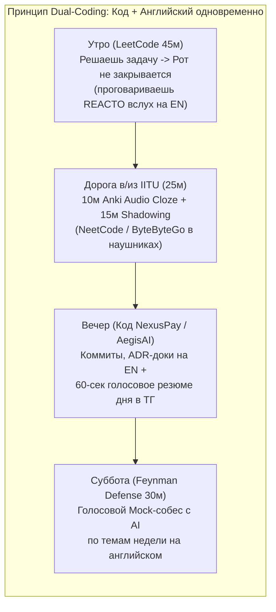

# Персональный 8-недельный Роадмап: Technical English (от A1+/A2 до прохождения Техсобесов и работы в EN-среде)

> [!IMPORTANT]
> **Твоя стартовая точка:** Студент 3 курса IITU (МУИТ), уровень активного разговорного английского — **A1+/A2** (читаешь документацию и слайды со словарем/переводчиком, знаешь термины глазами, но при попытке говорить вслух — ступор, перевод в голове с русского и нехватка слов).
> **Инженерный инсайт:** Тебе **не нужен** общий литературный английский (IELTS / C1, 12 времен, эссе про экологию — это занимает 600+ часов). Для техсобеса и работы в международной команде нужен **Operational Technical English (ESP)** — это ровно **5 грамматических формул**, **~60 синтаксических каркасов (Lego Sentence Frames)** и **~350 технических глаголов/связок**, доведенных до мышечного автоматизма.

---

## ЧАСТЬ 1. Анализ рынка (КЗ и Мир 2026–2027) и почему студенты IITU срезаются на английском

### 1.1. Почему в IITU номинально обучение на английском, а реальный Speaking остается на A1+/A2?
Аудит показывает классический феномен **«Input-Heavy, Output-Zero» (Пассивный потребитель)**:
1. **Чтение слайдов != Говорение:** В МУИТ ты видишь термины (`inheritance`, `deadlock`, `throughput`) в PDF-презентациях. Это тренирует только *пассивное узнавание (Recognition)*. Но обсуждение лаб с одногруппниками, сдача РК и бытовое общение идут на русском/казахском.
2. **Высокий когнитивный налог на перевод:** Когда на собеседовании тебя спрашивают *«Why did adding an index slow down your INSERTs?»*, твой мозг пытается: 1) перевести вопрос на русский, 2) придумать ответ на русском, 3) пословно перевести его на английский через школьные правила. Рабочая память переполняется, и наступает **Freezing (немой ступор)**.
3. **Угроза 2026–2027 года (Silent Coding = Auto-Reject):** Из-за массового читинга с AI-оверлеями, если кандидат на Live Coding молча пишет правильный код и не может синхронно комментировать ход мысли вслух (**Think-Aloud Protocol**), интервьюеры ставят метку **AI-cheating / No-Hire**.

---

### 1.2. Где и какой уровень реально требуют в Казахстане и глобально (2026–2027)

| Сегмент работодателей | Где проверяют английский | Реальный минимум (Speaking) | Что именно оценивают (Критерий Pass / Fail) |
| :--- | :--- | :--- | :--- |
| **Международные продуктовые хабы в КЗ** (*inDrive в Алматы, зарубежные R&D, Web3/AI резиденты Astana Hub*) | 1) HR Screening (15 мин) 2) Live Coding Think-Aloud 3) System Design / Tech Deep Dive 4) Behavioral Fit | **Operational B1+ / B2** | Никто не смотрит на акцент. Оценивают: 1) умение думать вслух во время кодинга, 2) объяснение причин выбора архитектуры (*trade-offs*), 3) способность работать в распределенной команде (США, ЕС, Латинская Америка, Кипр, КЗ). |
| **Глобальный энтерпрайз и консалтинг в КЗ** (*EPAM Kazakhstan, DataArt, Grid Dynamics, Big4 — Deloitte, PwC, EY, KPMG*) | 1) Выделенный **Language Assessment** (15–20 мин с сертифицированным ассессором) 2) **Client Interview** перед выходом из Lab в прод | **B1** (вход в стажерскую Lab) **B2** (выход на проект к заказчику) | В **EPAM** и **DataArt** проверяют: самопрезентацию, описание прошлого проекта и **Roleplay** (например: объяснить тимлиду/клиенту причину бага или уточнить требования к задаче). В **Big4** — запись видеоответов по таймеру (HireVue). |
| **Топ локального финтеха КЗ** (*Kaspi.kz, Halyk, Kolesa, Freedom, Jusan, Beeline/QazCode*) | Чтение документации, RFC, логов, GitHub, AI-промптинг; в международных стримах (QazCode, Freedom Global) — устный собес | **B1 Tech Reading/Writing** (для локальных команд) **B1+ Speaking** (для международных стримов) | Даже внутри русскоязычных/казахскоязычных команд весь код, коммиты, PR-ревью, документация Kubernetes/Spring/Kafka и работа с AI-агентами идут на 100% английском. |
| **Global Remote (US / EU стартапы, Toptal, Turing, BigTech стажировки)** | Все 4–5 раундов полностью на английском в высоком темпе | **Strong Operational B2** | Скорость реакции на follow-up вопросы (*"What if Kafka goes down?"*), структурность ответа (**Bottom Line Up Front**), владение профессиональной лексикой без пауз по 10 секунд. |

---

## ЧАСТЬ 2. Когнитивная методика SLA: Как прокачать английский с A2 за 8 недель за 0 лишних часов

Ты уже загружен основным техническим роадмапом и учебой на 3 курсе IITU. Если добавить 2 часа скучных учебников грамматики — ты выгоришь на 2-й неделе. Поэтому мы применяем **нейролингвистическое слияние (Habit Piggybacking + Dual-Coding)**: ты учишь английский **прямо внутри своего кодинга** + **25 минут в дороге**.

### 4 научных столпа твоего ускорения:
1. **Lexical Approach (Метод Лего-фраз Майкла Льюиса):**
   На уровне A2 мозг не успевает конструировать предложения из отдельных слов по правилам грамматики. Ты заучиваешь **готовые синтаксические каркасы (Sentence Frames)** целиком как макросы. В стрессе на собеседовании ты просто подставляешь технический термин в пустой слот: `To prevent [race conditions], we use [pessimistic locking].`
2. **Technique of Shadowing (Моторная прошивка речевого аппарата):**
   Проблема A2 — язык и губы физически не привыкли быстро произносить английские связки слов. Каждый день по дороге в МУИТ (15 минут в наушниках) ты включаешь 3-минутный технический разбор (**NeetCode**, **ByteByteGo**, **Hussein Nasser**) и **повторяешь вслух за спикером с задержкой в полсекунды**, копируя его ритм, паузы и интонацию. Один и тот же 3-минутный ролик гоняется 3 дня подряд до полного автоматизма.
3. **Запрет на русско-английские карточки словаря (Только Audio Cloze в Anki):**
   Никогда не учи карточки `причина = reason` — это заставляет мозг переводить в голове. Учи только фразы с пропуском и озвучкой:
   * *Лицевая сторона:* `If Kafka goes down, the Outbox table {{c1::will buffer the events}} until the broker recovers.`
   * *Правило зачета:* Карточка засчитывается только тогда, когда ты произнес всю фразу **вслух без запинки за 3 секунды**.
4. **Фонетический черный список (Топ-15 слов, на которых палятся программисты с A2):**
   Отработай произношение этих слов в первый же день, чтобы не резать слух интервьюеру:
   * `Thread` -> **[θred]** (с языком между зубами, не «срэд» и не «трэд» / `threat` — угроза).
   * `Cache` -> **[kæʃ]** (читается точно как `cash` — наличные, **не** «кэшэ» и **не** «каше»!).
   * `Queue` -> **[kjuː]** (читается просто как буква «Q», все остальные буквы немые).
   * `Schema` -> **[ˈskiːmə]** (читается «скима», через К, **не** «схема» и **не** «шема»).
   * `Null` -> **[nʌl]** (читается «нал», **не** «нуль»).
   * `Idempotent` -> **[ˌaɪdəmˈpoʊtənt]** («айдэм-поутэнт»).
   * `Asynchronous` -> **[eɪˈsɪŋkrənəs]** («эй-синкрэнэс», ударение на слог `син`).
   * `Latency` -> **[ˈleɪtənsi]** («лэйтэнси», не «латенси»).
   * `Throughput` -> **[ˈθruːpʊt]** («сру-пут» — пропускная способность).
   * `Deadlock` -> **[ˈdedlɒk]** («дэд-лок»).
   * `Query` -> **[ˈkwɪri]** («куири»).
   * `Integer` -> **[ˈɪntɪdʒər]** («интиджер», через ДЖ, не «интегер»).
   * `Daemon` -> **[ˈdiːmən]** («димэн»).
   * `Height` -> **[haɪt]** («хайт», заканчивается на Т, не «хейтч»).
   * `Determine` -> **[dɪˈtɜːrmɪn]** («дитёмин», не «детермайн»).

---

## ЧАСТЬ 3. Вся грамматика инженера за 15 минут (5 формул = 95% речи на собесе)

Забудь про 12 школьных времен. Вся техническая речь строится на **5 рельсах**:

| № | Грамматический паттерн | Когда включать на собесе / в работе | Железная формула и пример под твой стек |
| :--- | :--- | :--- | :--- |
| **1** | **Present Simple** *(Как всё устроено)* | Объяснение работы кода, JVM, БД, архитектуры проекта, алгоритма | **`[Component] + [Verb-s] + [Object]`** *"The controller **validates** the DTO and **calls** the service."* *"Under the hood, PostgreSQL **uses** MVCC to handle concurrent reads."* |
| **2** | **Past Simple vs Present Perfect** *(Что я сделал)* | Рассказ о пет-проектах (`NexusPay`, `AegisAI`), фикс багов, ежедневный стендап | **Past Simple (`V-ed / V2`) — история в прошлом:** *"In NexusPay, I **implemented** the Outbox pattern and **fixed** a deadlock."* **Present Perfect (`have + V3`) — свежий результат сейчас:** *"I **have opened** the PR and **pushed** the tests."* |
| **3** | **Conditionals 1 & 2** *(Сценарии отказа и нагрузки)* | Ответы на *"What happens if...?"* (падение сервера, гонка потоков, рост трафика в 10 раз) | **Type 1 (Реальный случай в коде): `If + [Present], ... will + [Verb]`** *"**If** Kafka **goes** down, the Outbox worker **will retry** later."* **Type 2 (Масштабирование): `If + [Past], I would + [Verb]`** *"**If** traffic **grew** by 10x, I **would add** a Redis cache."* |
| **4** | **Modals (`can`, `should`, `have to`, `might`)** *(Trade-offs и ревью)* | Обоснование решений, код-ревью, потенциальные узкие места | *"Virtual threads **can** scale I/O, but we **have to** avoid pinning."* *"We **should** use `record` here. Unbounded queues **might** cause OOM."* |
| **5** | **Passive Voice (`is/are + V3`)** *(Путь запроса / пайплайн)* | Описание движения данных (HTTP -> Сервис -> БД -> Kafka -> Чанкинг -> RAG) | **`[Data] + is/are + [V3] + by/in [Component]`** *"First, the request **is validated**, then the event **is saved** in the DB and **published** to Kafka."* |

---

## ЧАСТЬ 4. Аварийные Анти-Ступор Протоколы (Что говорить, когда завис или не понял вопрос)

На собеседовании с уровнем A2 самый страшный враг — **паника при непонимании вопроса на слух** или **забытом слове**. Заучи эти 3 таблицы наизусть в первую неделю — это твоя броня.

### Протокол А: «Я не расслышал / Не понял вопрос / Слишком быстро сказали»
> [!WARNING]
> **Никогда не кивай и не говори *"Yes"* наугад**, если не понял вопрос на 100%! И никогда не говори просто *"What? I don't understand"*. Вместо этого используй профессиональный переспрос (он дает +очки за сбор требований):

1. **Если человек проглотил слова или плохая связь:**
   * *"Sorry, the audio cut out for a second. Could you repeat the last part?"* (Извините, звук прервался на секунду. Можете повторить последнюю часть?)
   * *"Could you rephrase that slightly? I want to make sure I answer the exact question."* (Не могли бы вы слегка перефразировать? Хочу убедиться, что отвечаю точно на ваш вопрос.)
2. **Если ты услышал знакомое слово (например, `transaction` или `cache`), но не понял весь вопрос (Прием «Эхо-сужение»):**
   * *"Just to make sure we are on the same page — are you asking how [transactions] work under the hood, or how I used them in my project?"* (Чтобы убедиться, что мы поняли друг друга: вы спрашиваете, как транзакции работают под капотом, или как я применил их в проекте?)

### Протокол Б: «Забыл английское слово прямо посреди предложения»
Если забыл слово — **запрещено молчать и вспоминать перевод дольше 1 секунды**. Включай обход через простую фразу `It is the mechanism that...`:
* Забыл слово *«идемпотентность»* или *«дедупликация»* -> *"It is the mechanism that prevents processing the same payment twice."*
* Забыл слово *«инвалидация кэша»* -> *"It is the process when we delete old data from Redis after updating the database."*
* Запутал грамматику в длинном предложении -> Сбрось фразу мостиком: **"Let me put it simply:"** (*«Скажу проще:»*) и начни короткое предложение `Subject + Verb + Object`.

### Протокол В: «Мне нужно 5–7 секунд подумать над техническим ответом»
Не сиди в мертвой тишине с испуганными глазами. Произнеси фразу-мост (Time-Buying Bridge):
* *"That’s a good question. Let me take a few seconds to think through the edge cases."* (Хороший вопрос. Дайте мне пару секунд продумать граничные случаи.)
* *"Let’s trace what happens step by step when a request hits the service..."* (Давайте проследим шаг за шагом, что происходит, когда запрос приходит в сервис...)

---

## ЧАСТЬ 5. Боевой Корпус Скриптов под Твой Стек (Готовые шаблоны для заучивания)

### 5.1. Твой 75-секундный Self-Pitch ("Tell me about yourself")
Выучи этот текст как песню (методом Shadowing под диктофон). Он составлен на чистом, естественном инженерном английском без воды и сразу выводит разговор на твои сильные проекты:

> *"Hi! I’m a third-year Computer Science student at IITU focusing on Backend Engineering with **Java 21, Spring Boot 3, PostgreSQL, and Kafka**, as well as production **AI and RAG systems**.*
>
> *Recently, I’ve been building high-load, fault-tolerant backend systems. My main project is **NexusPay** — an event-driven payment core where I implemented a **double-entry ledger**, solved database deadlocks using **deterministic pessimistic locking**, and guaranteed event delivery to Kafka using the **Transactional Outbox pattern** and **Redis Lua rate limiting**.*
>
> *My second project is **AegisAI** — an autonomous code and incident assistant. There, I built a **Hybrid Search engine in PostgreSQL** combining **`pgvector` HNSW semantic search with BM25 full-text search and Reciprocal Rank Fusion**, which cut down hallucinations and improved context recall.*
>
> *I test my code thoroughly with **Testcontainers** and **k6**, and I’m excited to bring this hands-on engineering approach to your team."*

---

### 5.2. Полный речевой шаблон для Live Coding (Формула REACTO)

Когда тебе дали задачу на алгоритмы или SQL, иди строго по этим 6 ступеням вслух:

1. **R — Repeat & Clarify (Первая минута):**
   * *"So, we have an array of integers and we need to find [X], right?"*
   * *"Before I start coding, let me check the edge cases: can the input be empty or contain negative numbers?"*
2. **E — Examples:**
   * *"Let’s look at a quick example. If the input is `[2, 7, 11]` and the target is `9`, the output should be `[0, 1]`."*
3. **A — Approach (Brute Force -> Optimal):**
   * *"A naive brute-force approach would be two nested loops, which takes **Big O of N squared** ($O(N^2)$) time. That’s too slow."*
   * *"We can optimize this down to **linear time, Big O of N** ($O(N)$), by using a `HashMap` to store elements we have already seen. Does this approach sound good to you?"*
4. **C — Code (Комментируй, пока печатаешь):**
   * *"First, I’ll add a check for an empty input at the top."*
   * *"Here, I’m creating a `HashMap` where the key is the number and the value is its index."*
   * *"Now I iterate through the array and check if the complement exists in the map."*
5. **T — Test (Dry-run глазами по коду):**
   * *"Let’s dry-run this code on our example... On the first step, `i = 0`, we put `2` into the map. On the next step, we find `2` in the map and return the answer."*
6. **O — Optimize & Complexity:**
   * *"Time complexity is **Big O of N** because we iterate over the array once, and `HashMap` lookup is **Big O of 1** on average. Space complexity is also **Big O of N** to store up to N elements in the map."*

---

### 5.3. Короткие убойные ответы по твоему техстеку (A2 -> B2 Engineering Precision)

Выучи эти 10 карточек — они закрывают 80% устных вопросов на техсобесе:

1. **Java 21 Virtual Threads:**
   * *"OS threads are heavy — about 1 megabyte each. Virtual threads are lightweight and managed by the JVM. When a virtual thread hits blocking I/O like a DB query, the JVM unmounts it from the OS carrier thread so the CPU never sits idle. However, we must avoid `synchronized` blocks with I/O to prevent thread pinning."*
2. **Spring `@Transactional` & Proxies:**
   * *"Spring `@Transactional` works via AOP proxies created by a `BeanPostProcessor`. When an external caller invokes the method, the proxy opens a DB transaction and binds the connection to `ThreadLocal`. If we call a `@Transactional` method from inside the same class (**self-invocation**), it bypasses the proxy and no transaction is started."*
3. **Hibernate N+1 & Pagination Trap:**
   * *"The N+1 problem happens when Hibernate executes 1 query for parent entities and N extra queries for lazy child collections. We fix it using `JOIN FETCH` or `@EntityGraph`. However, if we combine `JOIN FETCH` on a collection with pagination (`Pageable`), Hibernate loads the entire table into JVM memory and paginates in memory, causing an `OutOfMemoryError`. To fix this, we first fetch paginated IDs, and then `JOIN FETCH` by those IDs."*
4. **PostgreSQL MVCC & VACUUM:**
   * *"PostgreSQL uses MVCC. An `UPDATE` does not overwrite the row in place — it inserts a new tuple version with a new `xmin` transaction ID and marks the old tuple with `xmax`. This means readers never block writers. Later, `Autovacuum` removes dead tuples to prevent table bloat."*
5. **Deadlocks & Lost Updates (`NexusPay`):**
   * *"Under `Read Committed`, two concurrent transfers can cause a **Lost Update**. In `NexusPay`, I used pessimistic locking (`SELECT ... FOR UPDATE`). To make deadlocks mathematically impossible when Account A pays Account B and B pays A simultaneously, I always sort account IDs in ascending order before locking."*
6. **Dual-Write & Transactional Outbox (`NexusPay`):**
   * *"If we save to Postgres and send to Kafka directly, one can fail, leaving data inconsistent. With the **Transactional Outbox pattern**, we insert both the payment and the outbox event in a single local ACID transaction. A background worker polls the outbox using `FOR UPDATE SKIP LOCKED` and publishes to Kafka. On the consumer side, we deduplicate events by `event_id` in an Inbox table."*
7. **Redis Cache Stampede & Lua Rate Limiter:**
   * *"When a popular cache key expires under high load, thousands of requests hit the database at once — that’s a **Cache Stampede**. We prevent it by using a lock so only one thread rebuilds the cache, plus adding random **jitter** to the TTL. For rate limiting, I use a **Lua script** in Redis because Redis executes Lua atomically without race conditions."*
8. **Kubernetes Probes & Graceful Shutdown:**
   * *"In Kubernetes, the **Readiness probe** tells K8s when the pod is ready to receive traffic. The **Liveness probe** restarts the pod if it hangs. Critically, we must **never** check the database inside a Liveness probe — otherwise, a temporary DB hiccup will cause K8s to restart all pods at once."*
9. **Hybrid RAG (`AegisAI`):**
   * *"Pure vector search (`pgvector` HNSW) understands semantic meaning, but it misses exact class names or error codes. In `AegisAI`, I built **Hybrid Search**: we run vector search and PostgreSQL `GIN` full-text search in parallel, merge the rankings with **Reciprocal Rank Fusion (RRF)**, and pass the top results through a **Cross-Encoder Reranker**."*
10. **AI Evals & Guardrails (`AegisAI`):**
    * *"To prevent hallucinations and measure quality scientifically, I created a Golden Dataset and ran automated **RAGAS evaluations** measuring **Context Recall** and **Faithfulness** in CI/CD. Before calling the LLM, a guardrail filter strips secrets and PII and checks for prompt injections."*

---

### 5.4. Шпаргалка для ежедневной работы (Daily Standup, PR Review, Slack)

* **Шаблон на Daily Standup (30 секунд — проговаривай каждое утро):**
  * *"Yesterday, I implemented `[feature X]` and wrote integration tests with Testcontainers. Today, I’m going to open the PR and start working on `[task Y]`. No blockers on my side."*
* **Как попросить помощь в командном чате (Slack / Teams):**
  * *"Hi @Name! Quick question about `[service/topic]`. I’m working on `[ticket]` and noticed `[symptom]`. I already checked `[logs / class X]` and suspect `[hypothesis]`. Could you confirm if this is expected behavior?"*
* **Вежливый комментарий на Code Review:**
  * *"It looks like this query inside the loop might cause an N+1 issue under load. What do you think about moving it to a single batch query with `WHERE id IN (...)`?"*

---

## ЧАСТЬ 6. Понедельный План Языковой Прокачки (Синхронизированный с Тех-Роадмапом)

Этот план идет **поверх твоего 8-недельного технического роадмапа** как звуковая дорожка:

| Неделя | Тема в Тех-Роадмапе | Языковой фокус недели (25 мин в пути + во время кодинга) | Субботний Экзамен (Voice AI / Диктофон) |
| :--- | :--- | :--- | :--- |
| **Неделя 1** | JVM, Java 21 Concurrency, Spring Core, старт `NexusPay` | **Фонетическая чистка (15 слов из черного списка) + Шаблоны Live Coding (REACTO)** + 5 базовых грамматических формул. | Решить 2 задачи LeetCode вслух на английском (0 слов по-русски) + рассказать про Stack vs Heap и Virtual Threads за 3 минуты. |
| **Неделя 2** | PostgreSQL Internals, MVCC, Индексы, Hibernate N+1, Idempotency | **Связки Причина-Следствие (`Under the hood`, `This leads to`, `To prevent`)** + словарь БД и транзакций. | Устно объяснить: как работает MVCC, почему `UPDATE` = `DELETE + INSERT`, и как ты защитил `NexusPay` от Deadlock и Lost Update. |
| **Неделя 3** | Kafka, Transactional Outbox/Inbox, Saga, Redis Highload | **Conditionals 1 & 2 (`If Kafka goes down...`) + Passive Voice пайплайны** + **Анти-ступор протоколы А/Б/В**. | Защитить архитектуру `Outbox -> Kafka -> Inbox` и кэша Redis. Намеренно 3 раза применить Протокол А (переспросить AI-интервьюера) и Протокол Б (объяснить термин без называния слова). |
| **Неделя 4** | ClickHouse, Observability (OTel/Grafana), `k6` Load Testing | **Язык цифр, метрик и бенчмарков (`p99 latency dropped from X to Y ms`, `throughput`, `bottleneck`)** + Презентация `NexusPay` по STAR/XYZ. | **Mid-Term English Mock (30 мин):** 90-сек Self-Pitch + полный рассказ про `NexusPay` с цифрами нагрузочного теста `k6` + ответы на каверзные вопросы. |
| **Неделя 5** | AI Engineering, Embeddings, `pgvector` HNSW, Hybrid Search RRF | **Лексика поиска и AI (`semantic similarity`, `exact keyword match`, `trade-off between recall and latency`)**. | Устно объяснить на английском, почему чистый Vector Search ошибается на кодах ошибок и как работает твой SQL-запрос с RRF в `AegisAI`. |
| **Неделя 6** | AI Agents, Tool Calling, Structured Outputs, SSE Streaming | **Описание потоков и состояний (`state machine`, `human-in-the-loop`, `fallback`, `rate limit`)** + Daily Standup & Code Review фразы. | Провести симуляцию Daily Standup, устного Code Review чужого PR и объяснить работу графа агентов в `AegisAI`. |
| **Неделя 7** | AI Evals (RAGAS), Security Guardrails, Kubernetes & Probes | **Язык безопасности, K8s и инцидентов (`liveness vs readiness`, `rolling update`, `prompt injection`, `root cause`)**. | **Ролевая игра «Production Incident» на английском:** AI дает вводную («p99 вырос до 5 секунд после деплоя»), ты вслух расследуешь, локализуешь баг и предлагаешь откат + фикс. |
| **Неделя 8** | System Design, Поведенческое интервью (STAR), Штурм рынка | **5-шаговый скрипт System Design + 4 истории STAR** (сложный баг, архитектурный спор, жесткий дедлайн, личный вклад `"I" vs "We"`). | **Финальный 60-минутный Full English Interview:** 5 мин Pitch -> 20 мин Live Coding -> 20 мин System Design & Deep Dive -> 15 мин Behavioral STAR. |

---

## ЧАСТЬ 7. Твой Ежедневный Чек-лист (Распечатай или держи открытым)

1. **[Утро — 45 мин LeetCode]:** Решаю задачу — **говорю вслух на английском с первой секунды** (`Let's clarify the constraints...`, `Time complexity is Big O of N...`). Молча писать код запрещено.
2. **[Дорога в IITU — 25 мин в наушниках]:**
   * 10 минут: прогон 7–10 карточек **Anki (Audio Cloze)** вслух/вполголоса.
   * 15 минут: **Shadowing** одного 3-минутного видео (NeetCode / ByteByteGo) — повторяю синхронно за диктором, копируя произношение и связки.
3. **[Вечер — после кодинга, 3 минуты перед сном]:**
   * Пишу `git commit` и 3 строчки в `ADR` только на английском.
   * Открываю «Избранное» (Saved Messages) в Telegram и **с первой попытки без бумажки записываю 60-секундное голосовое сообщение на английском**: *1) What I implemented today, 2) What problem I faced, 3) How it works under the hood.*
4. **[Суббота — 30 минут]:** Включаю голосовой режим ИИ, вставляю системный промпт строгого интервьюера и защищаю темы недели голосом, используя **Анти-ступор протоколы** вместо молчания.
